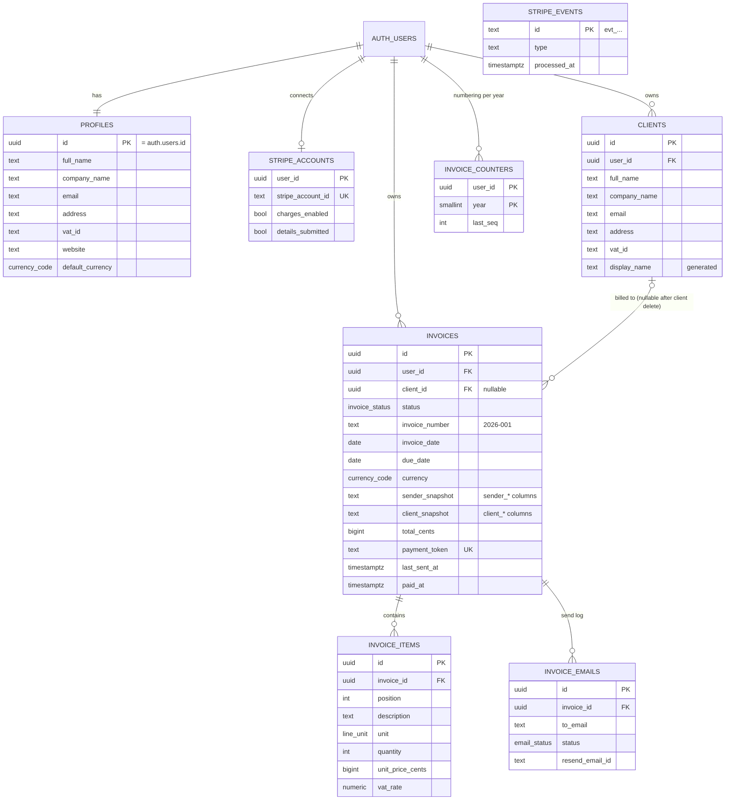

# Invoice Generator: Database Schema

| | |
|---|---|
| **Version** | 1.0 |
| **Date** | 24 Nov 2026 |
| **Database** | Supabase Postgres (15+) |
| **Related docs** | [PRD.md](PRD.md) · [Tech.md](Tech.md) |

This document defines the data model, constraints, triggers, Row Level Security (RLS) and storage for the product described in [PRD.md](PRD.md). §9 and §10 contain the SQL migrations, applied with the Supabase MCP `apply_migration`:

| Migration | Version | Applied | Checks |
|---|---|---|---|
| `001_initial_schema` (§9) | `20261124174600` | 24 Nov 2026 | §9.1 passed |
| `002_clients` (§10) | `20261125013433` | 25 Nov 2026 | §10.1 passed |

---

## 1. Overview



### 1.1 Schemas

| Schema | Contents | Exposed via Data API |
|---|---|---|
| `public` | All app tables, enums, RPC functions | Yes. **RLS enabled on every table** |
| `private` | `invoice_counters`, trigger functions | No |
| `storage` | Bucket `invoice-pdfs` + policies | Supabase Storage API |
| `auth` | Supabase Auth (`auth.users`) | Managed by Supabase |

### 1.2 Design decisions

| Decision | Why |
|---|---|
| **Money as integer cents (`bigint`)** | No floating-point errors. All 4 currencies (EUR, USD, BAM, GBP) have 2 decimals |
| **VAT rate as `numeric(5,2)`** | Typed freely by the user, 0–100 with up to 2 decimals (e.g. `7.50`) |
| **Snapshots as columns on `invoices`** (`sender_*`, `client_*`) | Invoices keep the data they were created with (PRD §6.2/6.4). Typed columns can be searched and shown in lists without joins. Deleted clients' paid invoices keep their data |
| **Computed amounts stored** (`net_cents`, `vat_cents`, `subtotal/tax/total_cents`) | The PDF, list and dashboard always show exactly what was calculated at save time. The app computes them with one shared function (Tech.md §7) |
| **`client_id` → `on delete set null`** | Hard client delete is allowed; paid invoices survive with their snapshot |
| **Status enum `draft / unpaid / paid`** + computed "overdue" | Matches PRD lifecycle. Overdue = `status = 'unpaid' and due_date < current_date` |
| **Business invariants in triggers, ownership in RLS** | RLS answers *whose row*. Triggers answer *is this change allowed* (paid lock, numbering). Triggers also apply to the secret-key (admin) client, which bypasses RLS |
| **`stripe_accounts` separate, read-only for users** | Users could otherwise point their invoices at someone else's Stripe account through the Data API. Only the server (secret key) writes it |
| **Numbering in a private counter table** | Atomic per-user, per-year sequence (`2026-001`) assigned by a trigger. Users can't read or tamper with counters |
| **UUID primary keys** (`gen_random_uuid()`) | Safe to expose in URLs, no enumeration |

---

## 2. Enums

| Enum | Values | Used by |
|---|---|---|
| `invoice_status` | `draft`, `unpaid`, `paid` | `invoices.status` (UI labels: Draft, Not paid, Paid) |
| `currency_code` | `EUR`, `USD`, `BAM`, `GBP` | `profiles.default_currency`, `invoices.currency`, `invoices.payment_currency`, `invoices.paid_currency` |
| `line_unit` | `hours`, `flat` | `invoice_items.unit` |
| `payment_method` | `stripe`, `manual` | `invoices.paid_method` |
| `email_status` | `sent`, `failed` | `invoice_emails.status` |

---

## 3. Tables

Every table has `created_at timestamptz not null default now()`. Mutable tables also have `updated_at`, maintained by a trigger.

### 3.1 `profiles`

One row per user, created automatically when a user signs up. Holds the sender details ("From") and preferences.

| Column | Type | Null | Default | Notes |
|---|---|:-:|---|---|
| `id` | `uuid` | | | PK, FK → `auth.users(id)` **on delete cascade** |
| `full_name` | `text` | ✓ | | ≤ 200 chars |
| `company_name` | `text` | ✓ | | ≤ 200 |
| `email` | `text` | ✓ | | Pre-filled with sign-up email. Reply-to on invoice emails. ≤ 320 |
| `address` | `text` | ✓ | | Multi-line, ≤ 2,000 |
| `vat_id` | `text` | ✓ | | ≤ 100 |
| `website` | `text` | ✓ | | ≤ 500 |
| `default_currency` | `currency_code` | | `'EUR'` | |
| `created_at`, `updated_at` | `timestamptz` | | `now()` | |

### 3.2 `stripe_accounts`

The user's connected Stripe account. **Users can read their own row. Only the server (secret key) writes.**

| Column | Type | Null | Default | Notes |
|---|---|:-:|---|---|
| `user_id` | `uuid` | | | PK, FK → `auth.users(id)` on delete cascade |
| `stripe_account_id` | `text` | | | Unique (`acct_…`) |
| `charges_enabled` | `boolean` | | `false` | Synced from Stripe (`account.updated`). Payment links are included only when `true` |
| `details_submitted` | `boolean` | | `false` | Onboarding finished. Used for "Setup incomplete" |
| `created_at`, `updated_at` | `timestamptz` | | `now()` | |

### 3.3 `clients`

| Column | Type | Null | Default | Notes |
|---|---|:-:|---|---|
| `id` | `uuid` | | `gen_random_uuid()` | PK |
| `user_id` | `uuid` | | `auth.uid()` | FK → `auth.users(id)` on delete cascade |
| `full_name` | `text` | ✓ | | ≤ 200 |
| `company_name` | `text` | ✓ | | ≤ 200 |
| `email` | `text` | ✓ | | ≤ 320. Needed to send invoices |
| `address` | `text` | ✓ | | ≤ 2,000 |
| `vat_id` | `text` | ✓ | | ≤ 100 |
| `display_name` | `text` | ✓ | generated | **Generated, stored:** first non-blank of company name → full name → email (PRD §6.4). Null if the client only has an address or VAT ID (the app shows "Unnamed client"). Used to sort and label clients; can't be written |
| `created_at`, `updated_at` | `timestamptz` | | `now()` | |

**Check:** at least one of the five data fields is non-blank (PRD §6.4).

The database collation (`en_US.UTF-8`) already sorts case-insensitively, so lists use a plain `order by display_name`.

### 3.4 `invoices`

| Column | Type | Null | Default | Notes |
|---|---|:-:|---|---|
| `id` | `uuid` | | `gen_random_uuid()` | PK |
| `user_id` | `uuid` | | `auth.uid()` | FK → `auth.users(id)` on delete cascade. Immutable |
| `client_id` | `uuid` | ✓ | | FK → `clients(id)` **on delete set null**. Null for drafts without a client, or after the client was deleted |
| `status` | `invoice_status` | | `'draft'` | |
| **Numbering** | | | | Set by trigger on insert. **Immutable** |
| `invoice_number` | `text` | | | `2026-001`. Unique per user |
| `invoice_year` | `smallint` | | | Year of `invoice_date` at first save |
| `invoice_seq` | `integer` | | | Sequence within user + year |
| **Header** | | | | |
| `invoice_date` | `date` | | `current_date` | |
| `due_date` | `date` | | `current_date + 14` | `≥ invoice_date` |
| `currency` | `currency_code` | | `'EUR'` | App sets it from the profile default |
| `comments` | `text` | ✓ | | Footer text, ≤ 2,000 |
| **Sender snapshot** | | | | Copied from `profiles` |
| `sender_full_name` | `text` | ✓ | | |
| `sender_company_name` | `text` | ✓ | | |
| `sender_email` | `text` | ✓ | | |
| `sender_address` | `text` | ✓ | | |
| `sender_vat_id` | `text` | ✓ | | |
| `sender_website` | `text` | ✓ | | |
| **Client snapshot** | | | | Copied from `clients` |
| `client_full_name` | `text` | ✓ | | |
| `client_company_name` | `text` | ✓ | | |
| `client_email` | `text` | ✓ | | Send-to address |
| `client_address` | `text` | ✓ | | |
| `client_vat_id` | `text` | ✓ | | |
| `client_display_name` | `text` | ✓ | | Company → Full name → Email. Set by the app. Used for list display and search |
| **Totals** | | | | Computed by the app on save |
| `subtotal_cents` | `bigint` | | `0` | ≥ 0 |
| `tax_cents` | `bigint` | | `0` | ≥ 0 |
| `total_cents` | `bigint` | | `0` | ≥ 0, `= subtotal + tax` |
| **PDF** | | | | |
| `content_hash` | `text` | ✓ | | SHA-256 of all PDF-visible content (current state) |
| `pdf_path` | `text` | ✓ | | `{user_id}/{id}.pdf` in bucket `invoice-pdfs`. Null for drafts |
| `pdf_content_hash` | `text` | ✓ | | `content_hash` at the time the stored PDF was generated. Mismatch means the PDF is stale |
| `pdf_generated_at` | `timestamptz` | ✓ | | |
| **Sending** | | | | |
| `first_sent_at` | `timestamptz` | ✓ | | Null means never sent |
| `last_sent_at` | `timestamptz` | ✓ | | Shown as "Sent on …" |
| `last_sent_content_hash` | `text` | ✓ | | `content_hash` at last send. Used for the resend prompt |
| **Payment link** | | | | Set on a successful send that included a payment link |
| `payment_token` | `text` | ✓ | | Unique, random (≥ 32 chars, base64url). `/pay/{token}` |
| `payment_amount_cents` | `bigint` | ✓ | | Amount the link charges (total at last send with link) |
| `payment_currency` | `currency_code` | ✓ | | Currency the link charges |
| `stripe_checkout_session_id` | `text` | ✓ | | Latest Checkout Session (expired when a new one is created, on delete, on manual paid) |
| **Payment** | | | | Set when status becomes `paid`. Not shown in UI except dashboard |
| `paid_at` | `timestamptz` | ✓ | | |
| `paid_method` | `payment_method` | ✓ | | `stripe` or `manual` |
| `paid_amount_cents` | `bigint` | ✓ | | Stripe: `amount_total`. Manual: `total_cents` |
| `paid_currency` | `currency_code` | ✓ | | |
| `created_at`, `updated_at` | `timestamptz` | | `now()` | |

**Checks**
- `due_date >= invoice_date`
- totals `≥ 0`, `total_cents = subtotal_cents + tax_cents`
- paid fields are all set **if and only if** `status = 'paid'`
- payment link fields (`payment_token`, `payment_amount_cents`, `payment_currency`) are all null or all set
- drafts have never been sent (`status <> 'draft' or first_sent_at is null`)
- `char_length(comments) <= 2000`

### 3.5 `invoice_items`

| Column | Type | Null | Default | Notes |
|---|---|:-:|---|---|
| `id` | `uuid` | | `gen_random_uuid()` | PK |
| `invoice_id` | `uuid` | | | FK → `invoices(id)` **on delete cascade**. Immutable |
| `user_id` | `uuid` | | `auth.uid()` | FK → `auth.users(id)` on delete cascade. Denormalized for fast RLS |
| `position` | `integer` | | | Display order, ≥ 0. Unique per invoice |
| `description` | `text` | | `''` | ≤ 500. May be empty on drafts |
| `unit` | `line_unit` | | `'hours'` | |
| `quantity` | `integer` | | `1` | ≥ 1. `flat` ⇒ must be `1` |
| `unit_price_cents` | `bigint` | | `0` | ≥ 0, before VAT |
| `vat_rate` | `numeric(5,2)` | | `0` | 0–100 |
| `net_cents` | `bigint` | | `0` | `quantity × unit_price_cents` |
| `vat_cents` | `bigint` | | `0` | Rounded per line |
| `created_at` | `timestamptz` | | `now()` | |

**Checks:** `quantity >= 1`, `unit <> 'flat' or quantity = 1`, `unit_price_cents >= 0`, `vat_rate between 0 and 100`, `net_cents = quantity * unit_price_cents`, `vat_cents >= 0`.

### 3.6 `invoice_emails`

Log of every send attempt (success or failure). Used for debugging and for support. The UI doesn't show it in v1.

| Column | Type | Null | Default | Notes |
|---|---|:-:|---|---|
| `id` | `uuid` | | `gen_random_uuid()` | PK |
| `invoice_id` | `uuid` | | | FK → `invoices(id)` on delete cascade |
| `user_id` | `uuid` | | `auth.uid()` | FK → `auth.users(id)` on delete cascade |
| `to_email` | `text` | | | |
| `subject` | `text` | | | |
| `message` | `text` | | | The (possibly edited) message, ≤ 5,000 |
| `included_payment_link` | `boolean` | | `false` | |
| `payment_amount_cents` | `bigint` | ✓ | | Amount the link charged at that send |
| `status` | `email_status` | | | `sent` / `failed` |
| `resend_email_id` | `text` | ✓ | | Resend message id on success |
| `error` | `text` | ✓ | | Error message on failure |
| `created_at` | `timestamptz` | | `now()` | |

### 3.7 `stripe_events`

Webhook idempotency. **No user access. Secret-key client only.**

| Column | Type | Null | Default | Notes |
|---|---|:-:|---|---|
| `id` | `text` | | | PK, Stripe event id (`evt_…`) |
| `type` | `text` | | | e.g. `checkout.session.completed` |
| `account` | `text` | ✓ | | Connected account id (`acct_…`) |
| `received_at` | `timestamptz` | | `now()` | |
| `processed_at` | `timestamptz` | ✓ | | Null means received but not (successfully) processed. A retry will process it |

### 3.8 `private.invoice_counters`

Not exposed. Only touched by the numbering trigger.

| Column | Type | Notes |
|---|---|---|
| `user_id` | `uuid` | PK part, FK → `auth.users(id)` on delete cascade |
| `year` | `smallint` | PK part |
| `last_seq` | `integer` | Last number issued for that user and year |

---

## 4. Functions & triggers

| Name | Kind | Security | Purpose |
|---|---|---|---|
| `private.set_updated_at()` | trigger fn | invoker | Sets `updated_at = now()` on update (profiles, stripe_accounts, clients, invoices) |
| `private.handle_new_user()` | trigger fn on `auth.users` **after insert** | **definer** | Creates the `profiles` row with `email = new.email` |
| `private.assign_invoice_number()` | trigger fn on `invoices` **before insert** | **definer** (to reach `private.invoice_counters`) | Atomically increments the user+year counter and sets `invoice_year`, `invoice_seq`, `invoice_number` (`2026-001`; no truncation past 999 → `2026-1000`). Rejects inserts for another user |
| `private.protect_invoice()` | trigger fn on `invoices` **before insert/update/delete** | invoker | **Insert:** can't create as `paid`. **Delete:** paid can't be deleted. **Update:** a paid row is immutable, *except* `client_id → null` caused by client deletion. Number/owner are immutable. No `unpaid → draft`, no `draft → paid` |
| `private.protect_invoice_items()` | trigger fn on `invoice_items` **before insert/update/delete** | invoker | Rejects any change when the parent invoice is `paid`. `invoice_id` is immutable |
| `public.save_invoice(p_invoice jsonb, p_items jsonb)` | RPC | **invoker** (RLS applies) | Creates or updates an invoice (status `draft` or `unpaid` only) and **replaces** its line items in one transaction. Returns the invoice row |
| `public.dashboard_summary()` | RPC | **invoker** (RLS applies) | Per currency: `outstanding_count`, `outstanding_cents`, `overdue_count`, `overdue_cents`, `paid_this_month_cents` (by `paid_currency`, current UTC month) |
| `public.delete_client(p_client_id uuid, p_delete_unpaid boolean default false)` | RPC | **invoker** (RLS applies) | Deletes a client in one transaction. With `p_delete_unpaid`, first deletes its `draft` / `unpaid` invoices and **returns** their `invoice_id`, `pdf_path`, `stripe_checkout_session_id` so the app can clean up. Other invoices (all paid ones) are kept and the FK clears their `client_id`. Raises `P0002` if the client doesn't exist or isn't the caller's |

> **Note on deleting users:** because paid invoices can't be deleted, deleting an `auth.users` row that owns paid invoices fails (the cascade hits the paid-lock trigger). That's acceptable because account deletion is out of scope (PRD §3.2). If it's needed later, add an explicit bypass to `protect_invoice` (e.g. a transaction-local setting that only a server-side "delete account" function sets).

**Status transitions allowed by the DB**

| From \ To | draft | unpaid | paid |
|---|:-:|:-:|:-:|
| *(insert)* | ✓ | ✓ | ✗ |
| draft | ✓ | ✓ | ✗ |
| unpaid | ✗ | ✓ | ✓ |
| paid | ✗ | ✗ | ✗ (immutable) |

---

## 5. Row Level Security

RLS is **enabled on every table in `public`**. All policies target `to authenticated` and wrap `auth.uid()` in `(select …)` so it's evaluated once per query. `anon` gets no table privileges. The secret-key client (`service_role`) bypasses RLS and is used only in the places listed in Tech.md §6.1.

| Table | SELECT | INSERT | UPDATE | DELETE |
|---|---|---|---|---|
| `profiles` | own (`id = uid`) | — (trigger creates) | own (USING + WITH CHECK). Column grant limits to the editable fields | — (cascade from `auth.users`) |
| `stripe_accounts` | own | — (server only) | — (server only) | — (server only) |
| `clients` | own | own | own (USING + WITH CHECK) | own |
| `invoices` | own | own | own (USING + WITH CHECK) | own |
| `invoice_items` | own | own **and** parent invoice is own | own (USING) / own **and** parent own (WITH CHECK) | own |
| `invoice_emails` | own | own **and** parent invoice is own | — | — (cascade) |
| `stripe_events` | — | — | — | — (server only, no grants) |

*own* = `(select auth.uid()) = user_id` (or `= id` for `profiles`).

Paid-lock rules aren't in the policies. They're in triggers (§4), so they also apply to the secret-key client.

**Grants:** `anon` has nothing. `authenticated` gets exactly the privileges matching the policies above (e.g. `select` only on `stripe_accounts`; `update(full_name, company_name, email, address, vat_id, website, default_currency)` on `profiles`). `service_role` gets full access to app tables. RPC functions: `execute` is revoked from `public` and `anon` and granted to `authenticated` (`save_invoice`, `dashboard_summary`, `delete_client`).

---

## 6. Indexes

| Table | Index | Purpose |
|---|---|---|
| `clients` | `(user_id)` | RLS + list |
| `clients` | `(user_id, display_name, created_at)` | List sorted A→Z + pagination |
| `invoices` | **unique** `(user_id, invoice_number)` | Numbering integrity |
| `invoices` | `(user_id, invoice_date desc, created_at desc)` | Default list sort + pagination |
| `invoices` | `(user_id, status, due_date)` | Status / overdue filters, dashboard |
| `invoices` | `(client_id)` | FK, client filter, client details page |
| `invoices` | **unique** `(payment_token)` | Pay page lookup |
| `invoice_items` | **unique** `(invoice_id, position)` | Ordered items, FK |
| `invoice_items` | `(user_id)` | RLS |
| `invoice_emails` | `(invoice_id, created_at desc)` | FK, history |
| `invoice_emails` | `(user_id)` | RLS |
| `stripe_accounts` | **unique** `(stripe_account_id)` | Webhook lookup |

Search (`ilike` on `invoice_number`, `client_display_name`, `client_full_name`) runs within one user's rows, so it's fast enough without extra indexes. If needed later, add `pg_trgm` GIN indexes.

---

## 7. Storage

| Setting | Value |
|---|---|
| Bucket | `invoice-pdfs` |
| Public | **No** (private) |
| Allowed MIME types | `application/pdf` |
| Max file size | 10 MB |
| Object key | `{user_id}/{invoice_id}.pdf` (latest version only, overwritten on each save) |

Policies on `storage.objects` (all `to authenticated`, `bucket_id = 'invoice-pdfs'` and `(storage.foldername(name))[1] = (select auth.uid())::text`): **select**, **insert**, **update** (USING + WITH CHECK), **delete**. Upsert (overwrite) needs insert + select + update.

---

## 8. Conventions

- **Money:** integer cents (`bigint`). Never floats. Format only at the edges (UI, PDF, email).
- **Dates:** `invoice_date`, `due_date` are `date` (no time zone). Event times (`*_at`) are `timestamptz`.
- **Overdue:** never stored. Computed as `status = 'unpaid' and due_date < current_date`.
- **Naming:** lowercase `snake_case`, plural table names, `*_cents` for money, `*_at` for timestamps.
- **Migrations:** one SQL file per change, applied through the Supabase MCP `apply_migration` (or the CLI). After each one: regenerate TS types and run `get_advisors` (security + performance).

---

## 9. SQL migration: `001_initial_schema`

```sql
-- =====================================================================
-- 001_initial_schema: Invoice Generator
-- =====================================================================

create schema if not exists private;

-- ---------------------------------------------------------------------
-- Enums
-- ---------------------------------------------------------------------
create type public.invoice_status as enum ('draft', 'unpaid', 'paid');
create type public.currency_code  as enum ('EUR', 'USD', 'BAM', 'GBP');
create type public.line_unit      as enum ('hours', 'flat');
create type public.payment_method as enum ('stripe', 'manual');
create type public.email_status   as enum ('sent', 'failed');

-- ---------------------------------------------------------------------
-- Helper: updated_at
-- ---------------------------------------------------------------------
create or replace function private.set_updated_at()
returns trigger
language plpgsql
set search_path = ''
as $$
begin
  new.updated_at := now();
  return new;
end;
$$;

-- ---------------------------------------------------------------------
-- profiles
-- ---------------------------------------------------------------------
create table public.profiles (
  id               uuid primary key references auth.users (id) on delete cascade,
  full_name        text check (char_length(full_name) <= 200),
  company_name     text check (char_length(company_name) <= 200),
  email            text check (char_length(email) <= 320),
  address          text check (char_length(address) <= 2000),
  vat_id           text check (char_length(vat_id) <= 100),
  website          text check (char_length(website) <= 500),
  default_currency public.currency_code not null default 'EUR',
  created_at       timestamptz not null default now(),
  updated_at       timestamptz not null default now()
);

create trigger profiles_set_updated_at
  before update on public.profiles
  for each row execute function private.set_updated_at();

-- Create a profile for every new auth user
create or replace function private.handle_new_user()
returns trigger
language plpgsql
security definer
set search_path = ''
as $$
begin
  insert into public.profiles (id, email)
  values (new.id, new.email);
  return new;
end;
$$;

create trigger on_auth_user_created
  after insert on auth.users
  for each row execute function private.handle_new_user();

-- ---------------------------------------------------------------------
-- stripe_accounts (read-only for users; written by the server)
-- ---------------------------------------------------------------------
create table public.stripe_accounts (
  user_id           uuid primary key references auth.users (id) on delete cascade,
  stripe_account_id text not null unique,
  charges_enabled   boolean not null default false,
  details_submitted boolean not null default false,
  created_at        timestamptz not null default now(),
  updated_at        timestamptz not null default now()
);

create trigger stripe_accounts_set_updated_at
  before update on public.stripe_accounts
  for each row execute function private.set_updated_at();

-- ---------------------------------------------------------------------
-- clients
-- ---------------------------------------------------------------------
create table public.clients (
  id           uuid primary key default gen_random_uuid(),
  user_id      uuid not null default auth.uid() references auth.users (id) on delete cascade,
  full_name    text check (char_length(full_name) <= 200),
  company_name text check (char_length(company_name) <= 200),
  email        text check (char_length(email) <= 320),
  address      text check (char_length(address) <= 2000),
  vat_id       text check (char_length(vat_id) <= 100),
  created_at   timestamptz not null default now(),
  updated_at   timestamptz not null default now(),
  constraint clients_not_empty check (
    coalesce(
      nullif(btrim(full_name), ''),
      nullif(btrim(company_name), ''),
      nullif(btrim(email), ''),
      nullif(btrim(address), ''),
      nullif(btrim(vat_id), '')
    ) is not null
  )
);

create index clients_user_id_idx on public.clients (user_id);

create trigger clients_set_updated_at
  before update on public.clients
  for each row execute function private.set_updated_at();

-- ---------------------------------------------------------------------
-- invoices
-- ---------------------------------------------------------------------
create table public.invoices (
  id                         uuid primary key default gen_random_uuid(),
  user_id                    uuid not null default auth.uid() references auth.users (id) on delete cascade,
  client_id                  uuid references public.clients (id) on delete set null,
  status                     public.invoice_status not null default 'draft',

  -- numbering (set by trigger)
  invoice_number             text not null,
  invoice_year               smallint not null,
  invoice_seq                integer not null,

  -- header
  invoice_date               date not null default current_date,
  due_date                   date not null default (current_date + 14),
  currency                   public.currency_code not null default 'EUR',
  comments                   text check (char_length(comments) <= 2000),

  -- sender snapshot
  sender_full_name           text,
  sender_company_name        text,
  sender_email               text,
  sender_address             text,
  sender_vat_id              text,
  sender_website             text,

  -- client snapshot
  client_full_name           text,
  client_company_name        text,
  client_email               text,
  client_address             text,
  client_vat_id              text,
  client_display_name        text,

  -- totals (computed by the app)
  subtotal_cents             bigint not null default 0 check (subtotal_cents >= 0),
  tax_cents                  bigint not null default 0 check (tax_cents >= 0),
  total_cents                bigint not null default 0 check (total_cents >= 0),

  -- pdf
  content_hash               text,
  pdf_path                   text,
  pdf_content_hash           text,
  pdf_generated_at           timestamptz,

  -- sending
  first_sent_at              timestamptz,
  last_sent_at               timestamptz,
  last_sent_content_hash     text,

  -- payment link
  payment_token              text unique,
  payment_amount_cents       bigint check (payment_amount_cents > 0),
  payment_currency           public.currency_code,
  stripe_checkout_session_id text,

  -- payment
  paid_at                    timestamptz,
  paid_method                public.payment_method,
  paid_amount_cents          bigint check (paid_amount_cents >= 0),
  paid_currency              public.currency_code,

  created_at                 timestamptz not null default now(),
  updated_at                 timestamptz not null default now(),

  constraint invoices_due_after_invoice_date check (due_date >= invoice_date),
  constraint invoices_total_consistent check (total_cents = subtotal_cents + tax_cents),
  constraint invoices_paid_fields check (
    (status = 'paid'
      and paid_at is not null and paid_method is not null
      and paid_amount_cents is not null and paid_currency is not null)
    or
    (status <> 'paid'
      and paid_at is null and paid_method is null
      and paid_amount_cents is null and paid_currency is null)
  ),
  constraint invoices_payment_link_fields check (
    (payment_token is null and payment_amount_cents is null and payment_currency is null)
    or
    (payment_token is not null and payment_amount_cents is not null and payment_currency is not null)
  ),
  constraint invoices_draft_not_sent check (status <> 'draft' or first_sent_at is null)
);

create unique index invoices_user_number_key on public.invoices (user_id, invoice_number);
create index invoices_user_date_idx          on public.invoices (user_id, invoice_date desc, created_at desc);
create index invoices_user_status_due_idx    on public.invoices (user_id, status, due_date);
create index invoices_client_id_idx          on public.invoices (client_id);

-- ---------------------------------------------------------------------
-- invoice numbering
-- ---------------------------------------------------------------------
create table private.invoice_counters (
  user_id  uuid not null references auth.users (id) on delete cascade,
  year     smallint not null,
  last_seq integer not null,
  primary key (user_id, year)
);

create or replace function private.assign_invoice_number()
returns trigger
language plpgsql
security definer
set search_path = ''
as $$
declare
  v_year smallint;
  v_seq  integer;
begin
  -- Defence in depth: a signed-in user can only create their own invoices.
  if auth.uid() is not null and new.user_id is distinct from auth.uid() then
    raise exception 'Cannot create invoices for another user' using errcode = '42501';
  end if;

  v_year := extract(year from new.invoice_date)::smallint;

  insert into private.invoice_counters as c (user_id, year, last_seq)
  values (new.user_id, v_year, 1)
  on conflict (user_id, year) do update set last_seq = c.last_seq + 1
  returning c.last_seq into v_seq;

  new.invoice_year   := v_year;
  new.invoice_seq    := v_seq;
  new.invoice_number := v_year::text || '-' ||
    case when v_seq < 1000 then lpad(v_seq::text, 3, '0') else v_seq::text end;

  return new;
end;
$$;

create trigger invoices_assign_number
  before insert on public.invoices
  for each row execute function private.assign_invoice_number();

-- ---------------------------------------------------------------------
-- invoice invariants (paid lock, immutable number/owner, transitions)
-- ---------------------------------------------------------------------
create or replace function private.protect_invoice()
returns trigger
language plpgsql
set search_path = ''
as $$
begin
  if tg_op = 'INSERT' then
    if new.status = 'paid' then
      raise exception 'Invoices cannot be created as paid';
    end if;
    return new;
  end if;

  if tg_op = 'DELETE' then
    if old.status = 'paid' then
      raise exception 'Paid invoices cannot be deleted';
    end if;
    return old;
  end if;

  -- UPDATE
  if old.status = 'paid' then
    -- The only change allowed on a paid invoice: client link cleared
    -- by "on delete set null" when the client is deleted.
    if new.client_id is null
       and (to_jsonb(new) - 'client_id' - 'updated_at')
         = (to_jsonb(old) - 'client_id' - 'updated_at') then
      return new;
    end if;
    raise exception 'Paid invoices are locked';
  end if;

  if new.user_id        is distinct from old.user_id
     or new.invoice_number is distinct from old.invoice_number
     or new.invoice_year   is distinct from old.invoice_year
     or new.invoice_seq    is distinct from old.invoice_seq then
    raise exception 'Invoice owner and number cannot be changed';
  end if;

  if old.status = 'unpaid' and new.status = 'draft' then
    raise exception 'A finalized invoice cannot go back to draft';
  end if;

  if old.status = 'draft' and new.status = 'paid' then
    raise exception 'Finalize the invoice before marking it as paid';
  end if;

  return new;
end;
$$;

create trigger invoices_protect
  before insert or update or delete on public.invoices
  for each row execute function private.protect_invoice();

create trigger invoices_set_updated_at
  before update on public.invoices
  for each row execute function private.set_updated_at();

-- ---------------------------------------------------------------------
-- invoice_items
-- ---------------------------------------------------------------------
create table public.invoice_items (
  id               uuid primary key default gen_random_uuid(),
  invoice_id       uuid not null references public.invoices (id) on delete cascade,
  user_id          uuid not null default auth.uid() references auth.users (id) on delete cascade,
  position         integer not null check (position >= 0),
  description      text not null default '' check (char_length(description) <= 500),
  unit             public.line_unit not null default 'hours',
  quantity         integer not null default 1 check (quantity >= 1),
  unit_price_cents bigint not null default 0 check (unit_price_cents >= 0),
  vat_rate         numeric(5,2) not null default 0 check (vat_rate between 0 and 100),
  net_cents        bigint not null default 0,
  vat_cents        bigint not null default 0 check (vat_cents >= 0),
  created_at       timestamptz not null default now(),

  constraint invoice_items_flat_quantity check (unit <> 'flat' or quantity = 1),
  constraint invoice_items_net_consistent check (net_cents = quantity * unit_price_cents)
);

create unique index invoice_items_invoice_position_key on public.invoice_items (invoice_id, position);
create index invoice_items_user_id_idx on public.invoice_items (user_id);

create or replace function private.protect_invoice_items()
returns trigger
language plpgsql
set search_path = ''
as $$
declare
  v_invoice_id uuid;
  v_status     public.invoice_status;
begin
  if tg_op = 'DELETE' then
    v_invoice_id := old.invoice_id;
  else
    v_invoice_id := new.invoice_id;
  end if;

  if tg_op = 'UPDATE' and new.invoice_id <> old.invoice_id then
    raise exception 'Line items cannot be moved between invoices';
  end if;

  select i.status into v_status
  from public.invoices i
  where i.id = v_invoice_id;

  if v_status = 'paid' then
    raise exception 'Line items of a paid invoice are locked';
  end if;

  if tg_op = 'DELETE' then
    return old;
  end if;
  return new;
end;
$$;

create trigger invoice_items_protect
  before insert or update or delete on public.invoice_items
  for each row execute function private.protect_invoice_items();

-- ---------------------------------------------------------------------
-- invoice_emails (send log)
-- ---------------------------------------------------------------------
create table public.invoice_emails (
  id                    uuid primary key default gen_random_uuid(),
  invoice_id            uuid not null references public.invoices (id) on delete cascade,
  user_id               uuid not null default auth.uid() references auth.users (id) on delete cascade,
  to_email              text not null,
  subject               text not null,
  message               text not null check (char_length(message) <= 5000),
  included_payment_link boolean not null default false,
  payment_amount_cents  bigint,
  status                public.email_status not null,
  resend_email_id       text,
  error                 text,
  created_at            timestamptz not null default now()
);

create index invoice_emails_invoice_idx on public.invoice_emails (invoice_id, created_at desc);
create index invoice_emails_user_id_idx on public.invoice_emails (user_id);

-- ---------------------------------------------------------------------
-- stripe_events (webhook idempotency; server only)
-- ---------------------------------------------------------------------
create table public.stripe_events (
  id           text primary key,
  type         text not null,
  account      text,
  received_at  timestamptz not null default now(),
  processed_at timestamptz
);

-- ---------------------------------------------------------------------
-- RPC: save invoice + replace line items atomically
-- ---------------------------------------------------------------------
create or replace function public.save_invoice(p_invoice jsonb, p_items jsonb)
returns public.invoices
language plpgsql
security invoker
set search_path = ''
as $$
declare
  r         public.invoices;
  v_invoice public.invoices;
begin
  r := jsonb_populate_record(null::public.invoices, p_invoice);

  if r.status is null or r.status not in ('draft', 'unpaid') then
    raise exception 'save_invoice can only save draft or unpaid invoices' using errcode = '22023';
  end if;

  if r.id is null then
    insert into public.invoices (
      user_id, client_id, status, invoice_date, due_date, currency, comments,
      sender_full_name, sender_company_name, sender_email, sender_address, sender_vat_id, sender_website,
      client_full_name, client_company_name, client_email, client_address, client_vat_id, client_display_name,
      subtotal_cents, tax_cents, total_cents, content_hash
    ) values (
      (select auth.uid()), r.client_id, r.status, r.invoice_date, r.due_date, r.currency, r.comments,
      r.sender_full_name, r.sender_company_name, r.sender_email, r.sender_address, r.sender_vat_id, r.sender_website,
      r.client_full_name, r.client_company_name, r.client_email, r.client_address, r.client_vat_id, r.client_display_name,
      r.subtotal_cents, r.tax_cents, r.total_cents, r.content_hash
    )
    returning * into v_invoice;
  else
    update public.invoices set
      client_id           = r.client_id,
      status              = r.status,
      invoice_date        = r.invoice_date,
      due_date            = r.due_date,
      currency            = r.currency,
      comments            = r.comments,
      sender_full_name    = r.sender_full_name,
      sender_company_name = r.sender_company_name,
      sender_email        = r.sender_email,
      sender_address      = r.sender_address,
      sender_vat_id       = r.sender_vat_id,
      sender_website      = r.sender_website,
      client_full_name    = r.client_full_name,
      client_company_name = r.client_company_name,
      client_email        = r.client_email,
      client_address      = r.client_address,
      client_vat_id       = r.client_vat_id,
      client_display_name = r.client_display_name,
      subtotal_cents      = r.subtotal_cents,
      tax_cents           = r.tax_cents,
      total_cents         = r.total_cents,
      content_hash        = r.content_hash
    where id = r.id
    returning * into v_invoice;

    if not found then
      raise exception 'Invoice not found' using errcode = 'P0002';
    end if;
  end if;

  delete from public.invoice_items where invoice_id = v_invoice.id;

  insert into public.invoice_items (
    invoice_id, user_id, position, description, unit, quantity,
    unit_price_cents, vat_rate, net_cents, vat_cents
  )
  select
    v_invoice.id, v_invoice.user_id, i.position, coalesce(i.description, ''), i.unit, i.quantity,
    i.unit_price_cents, i.vat_rate, i.net_cents, i.vat_cents
  from jsonb_populate_recordset(null::public.invoice_items, coalesce(p_items, '[]'::jsonb)) as i;

  return v_invoice;
end;
$$;

-- ---------------------------------------------------------------------
-- RPC: dashboard summary (per currency)
-- ---------------------------------------------------------------------
create or replace function public.dashboard_summary()
returns table (
  currency              public.currency_code,
  outstanding_count     bigint,
  outstanding_cents     bigint,
  overdue_count         bigint,
  overdue_cents         bigint,
  paid_this_month_cents bigint
)
language sql
stable
security invoker
set search_path = ''
as $$
  with mine as (
    select *
    from public.invoices
    where user_id = (select auth.uid())
  ),
  facts as (
    select
      m.currency,
      1                                                    as is_outstanding,
      m.total_cents                                        as outstanding_cents,
      case when m.due_date < current_date then 1 else 0 end as is_overdue,
      case when m.due_date < current_date then m.total_cents else 0 end as overdue_cents,
      0::bigint                                            as paid_cents
    from mine m
    where m.status = 'unpaid'

    union all

    select
      m.paid_currency, 0, 0, 0, 0, m.paid_amount_cents
    from mine m
    where m.status = 'paid'
      and m.paid_at >= date_trunc('month', now())
  )
  select
    f.currency,
    sum(f.is_outstanding)::bigint,
    sum(f.outstanding_cents)::bigint,
    sum(f.is_overdue)::bigint,
    sum(f.overdue_cents)::bigint,
    sum(f.paid_cents)::bigint
  from facts f
  group by f.currency
  order by f.currency;
$$;

-- ---------------------------------------------------------------------
-- Row Level Security
-- ---------------------------------------------------------------------
alter table public.profiles        enable row level security;
alter table public.stripe_accounts enable row level security;
alter table public.clients         enable row level security;
alter table public.invoices        enable row level security;
alter table public.invoice_items   enable row level security;
alter table public.invoice_emails  enable row level security;
alter table public.stripe_events   enable row level security;

-- profiles
create policy "profiles_select_own" on public.profiles
  for select to authenticated
  using ((select auth.uid()) = id);

create policy "profiles_update_own" on public.profiles
  for update to authenticated
  using ((select auth.uid()) = id)
  with check ((select auth.uid()) = id);

-- stripe_accounts (read only)
create policy "stripe_accounts_select_own" on public.stripe_accounts
  for select to authenticated
  using ((select auth.uid()) = user_id);

-- clients
create policy "clients_select_own" on public.clients
  for select to authenticated
  using ((select auth.uid()) = user_id);

create policy "clients_insert_own" on public.clients
  for insert to authenticated
  with check ((select auth.uid()) = user_id);

create policy "clients_update_own" on public.clients
  for update to authenticated
  using ((select auth.uid()) = user_id)
  with check ((select auth.uid()) = user_id);

create policy "clients_delete_own" on public.clients
  for delete to authenticated
  using ((select auth.uid()) = user_id);

-- invoices
create policy "invoices_select_own" on public.invoices
  for select to authenticated
  using ((select auth.uid()) = user_id);

create policy "invoices_insert_own" on public.invoices
  for insert to authenticated
  with check ((select auth.uid()) = user_id);

create policy "invoices_update_own" on public.invoices
  for update to authenticated
  using ((select auth.uid()) = user_id)
  with check ((select auth.uid()) = user_id);

create policy "invoices_delete_own" on public.invoices
  for delete to authenticated
  using ((select auth.uid()) = user_id);

-- invoice_items
create policy "invoice_items_select_own" on public.invoice_items
  for select to authenticated
  using ((select auth.uid()) = user_id);

create policy "invoice_items_insert_own" on public.invoice_items
  for insert to authenticated
  with check (
    (select auth.uid()) = user_id
    and exists (
      select 1 from public.invoices i
      where i.id = invoice_id and i.user_id = (select auth.uid())
    )
  );

create policy "invoice_items_update_own" on public.invoice_items
  for update to authenticated
  using ((select auth.uid()) = user_id)
  with check (
    (select auth.uid()) = user_id
    and exists (
      select 1 from public.invoices i
      where i.id = invoice_id and i.user_id = (select auth.uid())
    )
  );

create policy "invoice_items_delete_own" on public.invoice_items
  for delete to authenticated
  using ((select auth.uid()) = user_id);

-- invoice_emails
create policy "invoice_emails_select_own" on public.invoice_emails
  for select to authenticated
  using ((select auth.uid()) = user_id);

create policy "invoice_emails_insert_own" on public.invoice_emails
  for insert to authenticated
  with check (
    (select auth.uid()) = user_id
    and exists (
      select 1 from public.invoices i
      where i.id = invoice_id and i.user_id = (select auth.uid())
    )
  );

-- stripe_events: RLS enabled, no policies (server only)

-- ---------------------------------------------------------------------
-- Grants (explicit; don't rely on Data API defaults)
-- ---------------------------------------------------------------------
revoke all on public.profiles, public.stripe_accounts, public.clients, public.invoices,
              public.invoice_items, public.invoice_emails, public.stripe_events
  from anon, authenticated;

grant select on public.profiles to authenticated;
grant update (full_name, company_name, email, address, vat_id, website, default_currency)
  on public.profiles to authenticated;
grant select on public.stripe_accounts to authenticated;
grant select, insert, update, delete on public.clients       to authenticated;
grant select, insert, update, delete on public.invoices      to authenticated;
grant select, insert, update, delete on public.invoice_items to authenticated;
grant select, insert                 on public.invoice_emails to authenticated;

grant select, insert, update, delete
  on public.profiles, public.stripe_accounts, public.clients, public.invoices,
     public.invoice_items, public.invoice_emails, public.stripe_events
  to service_role;

revoke execute on function public.save_invoice(jsonb, jsonb) from public, anon;
grant  execute on function public.save_invoice(jsonb, jsonb) to authenticated;

revoke execute on function public.dashboard_summary() from public, anon;
grant  execute on function public.dashboard_summary() to authenticated;

revoke all on schema private from public, anon, authenticated;

-- ---------------------------------------------------------------------
-- Storage: private PDF bucket
-- ---------------------------------------------------------------------
insert into storage.buckets (id, name, public, file_size_limit, allowed_mime_types)
values ('invoice-pdfs', 'invoice-pdfs', false, 10485760, array['application/pdf'])
on conflict (id) do nothing;

create policy "invoice_pdfs_select_own" on storage.objects
  for select to authenticated
  using (
    bucket_id = 'invoice-pdfs'
    and (storage.foldername(name))[1] = (select auth.uid())::text
  );

create policy "invoice_pdfs_insert_own" on storage.objects
  for insert to authenticated
  with check (
    bucket_id = 'invoice-pdfs'
    and (storage.foldername(name))[1] = (select auth.uid())::text
  );

create policy "invoice_pdfs_update_own" on storage.objects
  for update to authenticated
  using (
    bucket_id = 'invoice-pdfs'
    and (storage.foldername(name))[1] = (select auth.uid())::text
  )
  with check (
    bucket_id = 'invoice-pdfs'
    and (storage.foldername(name))[1] = (select auth.uid())::text
  );

create policy "invoice_pdfs_delete_own" on storage.objects
  for delete to authenticated
  using (
    bucket_id = 'invoice-pdfs'
    and (storage.foldername(name))[1] = (select auth.uid())::text
  );
```

### 9.1 Post-migration checks

Run these with `execute_sql` / `get_advisors` after applying:

1. `get_advisors` (security + performance) reports no errors (e.g. RLS enabled everywhere, no unindexed FKs).
2. Sign up two test users. Each sees only their own `profiles`, `clients`, `invoices`.
3. Insert three invoices for one user in 2026: numbers `2026-001`, `2026-002`, `2026-003`. A different user also gets `2026-001`.
4. Mark an invoice `paid`, then try `update` / `delete` on it and its items. All rejected.
5. Delete a client that has a paid invoice. The client is deleted, the invoice remains with `client_id = null` and its snapshot intact.
6. `select * from public.dashboard_summary()` returns correct per-currency numbers.
7. Upload/download a PDF as user A at `A/…`. User B can't read it.
8. Regenerate TypeScript types into `lib/supabase/database.types.ts`.

---

## 10. SQL migration: `002_clients`

```sql
-- Display name for sorting and listing (PRD §6.4: Company → Full name → Email)
alter table public.clients
  add column display_name text generated always as (
    coalesce(
      nullif(btrim(company_name), ''),
      nullif(btrim(full_name), ''),
      nullif(btrim(email), '')
    )
  ) stored;

create index clients_user_id_display_name_idx
  on public.clients (user_id, display_name, created_at);

-- ---------------------------------------------------------------------
-- RPC: delete a client, optionally with its Draft / Not paid invoices,
-- in one transaction. Paid invoices are kept: the FK clears client_id.
-- Returns the deleted invoices so the app can clean up PDFs and checkouts.
-- ---------------------------------------------------------------------
create or replace function public.delete_client(p_client_id uuid, p_delete_unpaid boolean default false)
returns table (invoice_id uuid, pdf_path text, stripe_checkout_session_id text)
language plpgsql
security invoker
set search_path = ''
as $$
begin
  -- RLS limits this to the caller's own clients. The lock also blocks new
  -- invoices for this client until the transaction ends.
  perform 1 from public.clients c where c.id = p_client_id for update;
  if not found then
    raise exception 'client not found' using errcode = 'P0002';
  end if;

  if p_delete_unpaid then
    return query
      delete from public.invoices i
       where i.client_id = p_client_id
         and i.status in ('draft', 'unpaid')
      returning i.id, i.pdf_path, i.stripe_checkout_session_id;
  end if;

  delete from public.clients c where c.id = p_client_id;
end;
$$;

revoke execute on function public.delete_client(uuid, boolean) from public, anon;
grant  execute on function public.delete_client(uuid, boolean) to authenticated;
```

### 10.1 Post-migration checks

Run in a transaction that rolls back, as two simulated users (`set local role authenticated` + `request.jwt.claims`):

1. `display_name` follows company → full name → email, is null when all three are blank, and sorts case-insensitively.
2. User B can't see, update or delete user A's clients, and `delete_client` on one raises `P0002`. So does a missing id.
3. `delete_client(id)` keeps paid, unpaid and draft invoices (`client_id` null, snapshot intact).
4. `delete_client(id, true)` removes and returns the draft and unpaid invoices; the paid one survives.
5. `anon` can't execute the function.
6. `get_advisors` reports nothing new; types are regenerated.
