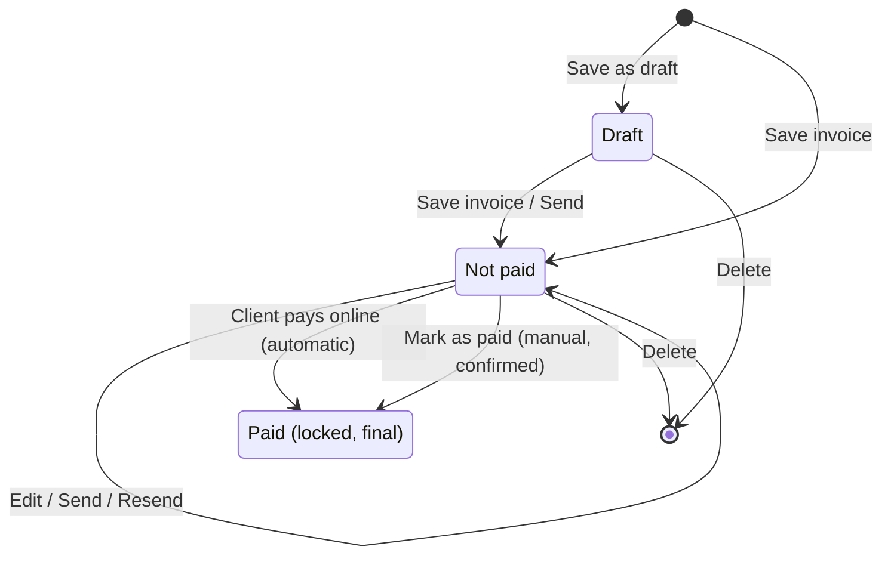

# Payable: Product Requirements

| | |
|---|---|
| **Version** | 1.0 |
| **Date** | 24 Nov 2026 |
| **Status** | Approved for development |
| **Related docs** | [Tech.md](Tech.md) (architecture) · [DB.md](DB.md) (database schema) · [UI-rules.md](UI-rules.md) (UI conventions) |

This document covers what the product does and how it behaves for the user and their clients. How it's built is in [Tech.md](Tech.md) and [DB.md](DB.md).

---

## 1. Overview

Payable is a web app for **freelancers** to create, store and send invoices to their clients, and to get paid online.

From one place, a freelancer can:

- enter their own sender details once,
- keep a list of clients,
- create invoices in a fixed, clean layout,
- get a PDF of each invoice,
- send the invoice to the client by email in one click, with the PDF attached and an online payment link,
- see which invoices are paid and which aren't, with paid status updating automatically when the client pays online.

### 1.1 Primary goal

A **simple and fast** invoicing tool. Going from "I need to bill this client" to "the client has the invoice and can pay it by card" should take a couple of minutes.

### 1.2 Principles

- **One user, own data.** No teams, organizations or shared workspaces. Each user sees only their own profile, clients, invoices and PDFs.
- **Fixed layout.** No logos, colours, templates or other branding options.
- **Paid is final.** Once an invoice is paid, it's locked.
- **Nothing is sent without the user's confirmation.**

---

## 2. Users

There's a single role: **User** (a freelancer).

A user can:

- register, confirm their email, log in, log out and reset a forgotten password,
- edit their profile (sender details) and default currency,
- connect their own Stripe account to receive online payments,
- create, view, edit and delete clients,
- create, edit, duplicate, delete, send and resend invoices,
- download invoice PDFs,
- mark invoices as paid manually,
- see a dashboard and a paginated list of their invoices.

A user **cannot** edit, delete, resend or un-pay an invoice that is **paid**.

The **client** (the freelancer's customer) never logs in. A client only:

- receives the invoice email,
- opens the PDF,
- opens the payment link and pays by card.

---

## 3. Scope

### 3.1 In scope (v1)

- Authentication: register with email confirmation, login, logout, forgot/reset password
- Profile / sender details, default currency
- Stripe account connection (each freelancer receives money into their own Stripe account)
- Client management (create, view, edit, delete)
- Invoices: draft, create, edit, duplicate, delete, automatic numbering, line items, VAT, totals
- PDF for each invoice
- Sending invoices by email with PDF attachment and payment link
- Resend prompt after editing a sent invoice
- Client-facing payment page and online card payment
- Automatic "paid" status after online payment; manual "Mark as paid"
- Invoice list with pagination, filters and search
- Invoice details / preview
- Dashboard

### 3.2 Out of scope (v1)

- Teams, organizations, multiple users per account
- Branding: logos, colours, custom layouts or templates
- Bank account details, interest and "type" fields on invoices
- Discounts, negative line items, decimal hours
- Mixed currencies on one invoice, currency conversion
- Partial payments, refunds through the app
- Payment methods other than card
- Payment confirmation emails (to the user or the client)
- Automatic payment reminders
- Multi-language UI or documents (English only)
- Account deletion and data export

### 3.3 Later (not v1, but don't block it)

- Marketing landing page, built section by section after the app is finished. Until then, a simple placeholder landing page with **Log in** / **Sign up**.
- CC/BCC the user on invoice emails
- Editable email subject
- Payment reminders
- Sending from the user's own email domain

---

## 4. Glossary

| Term | Meaning |
|---|---|
| **Draft** | An invoice that is saved but not finished. It can be incomplete (no client, no line items). It has an invoice number but no PDF and no payment link, and it can't be sent or marked as paid until it's finalized. |
| **Not paid** | A finished invoice waiting for payment. It can be edited, deleted, sent, resent and marked as paid. |
| **Paid** | The invoice has been paid, either online via Stripe or marked as paid by the user. Locked: no edits, no delete, no resend, no going back to Not paid. |
| **Overdue** | Not a separate status. A badge shown on a **Not paid** invoice whose due date has passed. |
| **Sent** | The invoice has been emailed to the client at least once. The app records when it was first and last sent. |
| **Payment link** | The link in the invoice email that takes the client to the pay page. It's included only when the user has connected Stripe. |
| **Pay page** | A public page (no login) where the client sees a short invoice summary and pays by card through Stripe. |
| **Sender details** | The user's profile data printed in the "From" section of an invoice. |
| **Snapshot** | The sender and client details are copied onto the invoice when it's created, so later changes to the profile or client don't change existing invoices. |

---

## 5. Invoice lifecycle

### 5.1 Transitions

| From | To | Triggered by | Notes |
|---|---|---|---|
| (new) | Draft | User clicks **Save as draft** | Relaxed validation. Number assigned. |
| (new) | Not paid | User clicks **Save invoice** | Full validation. Number assigned. PDF generated. |
| Draft | Not paid | User clicks **Save invoice** on a draft | Full validation. PDF generated. |
| Draft | Not paid (and sent) | User clicks **Send** on a draft | Full validation, then the send flow. |
| Not paid | Paid | Client pays on the pay page | Automatic. No email to anyone. |
| Not paid | Paid | User clicks **Mark as paid** and confirms | Irreversible. The payment link stops accepting payments. |
| Draft / Not paid | (deleted) | User clicks **Delete** and confirms | Permanent. The payment link stops working. |

Not allowed:

- Paid → anything (no edits, no delete, no un-pay)
- Not paid → Draft
- Draft → Paid (finalize first)

### 5.2 What each state allows

| Action | Draft | Not paid | Paid |
|---|:-:|:-:|:-:|
| View | ✓ | ✓ | ✓ |
| Edit | ✓ | ✓ | ✗ |
| Delete | ✓ | ✓ | ✗ |
| Send / Resend | ✓ (finalizes first) | ✓ | ✗ |
| Download PDF | ✗ (no PDF yet) | ✓ | ✓ |
| Duplicate | ✓ | ✓ | ✓ |
| Mark as paid | ✗ | ✓ | ✗ |

---

## 6. Feature requirements

Each feature lists user stories and **acceptance criteria (AC)**.

### 6.1 Authentication

**Stories**
- As a visitor, I can create an account with email and password.
- As a user, I can log in, log out and reset a forgotten password.

**AC**
1. Sign-up asks for email, password and password confirmation. The password must be at least 8 characters.
2. After sign-up, the user sees a "Check your email" screen. The account can't be used until the email address is confirmed via the link in the confirmation email.
3. Clicking the confirmation link logs the user in and takes them to the Dashboard.
4. Login with wrong credentials shows a generic error ("Invalid email or password"), without saying which part was wrong.
5. Login with an unconfirmed email shows a message explaining that the email must be confirmed, and offers to resend the confirmation email.
6. **Forgot password:** the user enters their email and always sees "If an account exists, we've sent a reset link". Following the link opens a "Set new password" screen. After saving, the user is logged in and taken to the Dashboard.
7. **Logout** is available from the app's navigation and returns the user to the landing page.
8. Every app page requires login. Visiting one while logged out redirects to login, and after logging in the user lands on the page they asked for.
9. Logged-in users who open login or sign-up are redirected to the Dashboard.
10. Auth emails (confirmation, password reset) come from the app's own email domain.

### 6.2 Profile / sender details

**Stories**
- As a user, I can enter my details once so they appear in the "From" section of every new invoice.

**Fields** (all optional):

| Field | Notes |
|---|---|
| Full Name | |
| Company Name | |
| Email | Pre-filled with the sign-up email; can be changed. Also used as the reply-to address on invoice emails. |
| Address | Multi-line |
| VAT ID | |
| Website | |
| Default currency | EUR, USD, BAM or GBP. Default **EUR**. Used for new invoices. |

**AC**
1. The user can save the profile with any combination of fields filled.
2. Email and Website, when filled in, must be valid formats.
3. New invoices automatically copy the current sender details (snapshot).
4. Changing the profile **doesn't** change existing invoices. An editable invoice has a **Refresh details** action that re-copies the current profile and client details onto it.
5. **Sending** any invoice is blocked until the profile has **(Full Name or Company Name) and Email**. Where sending is blocked, the app explains why and links to the profile page.

### 6.3 Payments connection (Stripe)

**Stories**
- As a user, I can connect my own Stripe account so clients can pay my invoices by card, with the money going straight to me.

**AC**
1. The settings area has a **Payments** section showing one of these states:
   - **Not connected:** a **Connect Stripe** button,
   - **Setup incomplete:** a **Continue setup** button (the user started but hasn't finished Stripe onboarding). When the user has submitted everything but Stripe hasn't enabled card payments yet, it says "Stripe is reviewing your details or needs more information",
   - **Connected:** a "Payments enabled" status, the connected account's name (or email), and a link to open the user's Stripe dashboard.
   After returning from Stripe's onboarding, a toast says "Stripe connected" or "Setup not finished yet".
2. **Connect Stripe** first asks where the user's business is based (a country select of the countries Stripe supports, default Croatia; Stripe needs the country to create the account and it can't be changed later). Then it takes the user through Stripe's own onboarding, which asks for all other details, and back to the app. **Continue setup** goes straight to Stripe.
3. Money from client payments goes directly into the user's Stripe account. **The app takes no fee.** Stripe's processing fees are paid by the user (through their Stripe account).
4. Only **card** payments are offered to clients.
5. Users can create, save **and send** invoices without connecting Stripe. Invoices sent while Stripe isn't connected contain **no payment link**, and the send dialog says so ("No payment link will be included. Connect Stripe to let clients pay online.").
6. If Stripe gets connected later, invoices sent earlier won't have a payment link until they are resent.

### 6.4 Clients

**Stories**
- As a user, I can keep a list of my clients and pick one when creating an invoice.

**Fields** (all optional, but **at least one** must be filled):

| Field | Notes |
|---|---|
| Full Name | |
| Company Name | |
| Email | Required to send invoices to this client |
| Address | Multi-line |
| VAT ID | |

**Display name** (used in lists and dropdowns): Company Name, otherwise Full Name, otherwise Email.

**AC**
1. **Clients list** shows display name, email, number of invoices and actions (view, edit, delete). Searchable by name, company or email.
2. **Client details** shows all fields and a list of that client's invoices (same columns and row actions as the invoice list, newest first, 20 per page, no filters), with a **View in invoices list** link that opens the invoice list filtered by this client.
3. **Create / edit client:** a form with the fields above. Email must be a valid format when filled in.
4. On the invoice form, the client is chosen from a **searchable dropdown**, which also has **+ Add new client**. That option opens a small form in a dialog and, after saving, selects the new client, without leaving the invoice.
5. A client without an email can be put on invoices, but **Send** is disabled for those invoices, with the explanation "This client has no email address".
6. **Delete client:**
   - A confirmation dialog explains that the client will be removed and that **paid invoices are kept** (with the client's details as they appear on those invoices).
   - If the client has Draft or Not paid invoices, the dialog also asks: **"Also delete N unpaid invoices for this client?"** (checkbox, unchecked by default). If any of them were already sent, the dialog warns that their payment links will stop working.
   - If the user keeps the unpaid invoices, they stay fully editable and sendable using the client details saved on them. When editing such an invoice, the client field shows the saved client name marked "(deleted client)", and the user can pick a different client.
7. Editing a client doesn't change existing invoices (see Snapshot). The **Refresh details** action on an editable invoice re-copies the current client details.

### 6.5 Create & edit invoice

**Stories**
- As a user, I can create an invoice by choosing a client and adding line items. The app calculates totals.
- As a user, I can save an unfinished invoice as a draft and come back to it later.

#### 6.5.1 Form layout

**Header**

| Field | Behaviour |
|---|---|
| From | Read-only block showing the sender details (snapshot from profile), with a link to edit the profile |
| To | Client dropdown (searchable, with "+ Add new client") |
| Invoice Number | Read-only, assigned automatically on first save ("Assigned on save" before that) |
| Invoice Date | Date picker. Default: **today** |
| Due Date | Date picker. Default: **invoice date + 14 days**, and it follows the invoice date (+14 days) until the user picks a due date themselves. Must be on or after the invoice date |
| Currency | EUR / USD / BAM / GBP. Default: the profile's default currency. One currency per invoice |

**Line items** (at least one row when finalizing, at most **100**; rows can be added, removed and moved up / down with buttons on each row). **Add line** starts the first row as Hours, quantity 1, VAT 0; later rows reuse the previous row's unit and VAT %.

| Column | Behaviour |
|---|---|
| Description | Free text |
| Unit | **Hours** or **Flat** |
| Quantity | Whole number ≥ 1 for Hours. Locked to **1** for Flat |
| Price | Unit price, before VAT, up to 2 decimals, ≥ 0 |
| VAT % | Typed freely, 0–100, up to 2 decimals. Default **0** |

Price and VAT % accept a dot or a comma as the decimal separator (`12.50` and `12,50` are the same). Thousands separators aren't accepted while typing.
| Amount | Read-only: Quantity × Price (before VAT) |

**Totals** (read-only, update live as the user types)

- **Subtotal**: sum of line amounts (before VAT)
- **VAT**: one row **per distinct VAT rate**, e.g. "VAT 17%: 34.00", "VAT 0%: 0.00". Rates whose VAT is zero are still listed if lines use them.
- **Total**: Subtotal + all VAT

**Footer**

- **Comments**: optional free text (e.g. payment terms, thank-you note)

#### 6.5.2 Calculations

- Line amount = Quantity × Price.
- Line VAT = Line amount × VAT% ÷ 100, **rounded to 2 decimals per line** (half up).
- VAT per rate = sum of the line VATs with that rate.
- Subtotal = sum of line amounts. Total = Subtotal + sum of all line VATs.
- All amounts are in the invoice's currency. There's no conversion.

#### 6.5.3 Numbering

- Format **`YYYY-NNN`**, e.g. `2026-001`, `2026-002` … `2026-999`, `2026-1000`.
- Numbers are **per user**. The sequence **restarts each year**. The year is the year of the **invoice date at the moment the invoice is first saved**.
- The number is assigned on the **first save** (draft or final) and never changes after that, even if the invoice date is edited later.
- The user can't enter or edit the number.
- Deleting an invoice leaves a **gap** in the sequence. Numbers are never reused.

#### 6.5.4 Saving

The form has two save buttons:

- **Save as draft:** saves whatever is entered (relaxed validation, see §7). The invoice stays a **Draft**. Only available while the invoice is a draft or brand new.
- **Save invoice:** full validation. The invoice becomes **Not paid** (if it was a draft or new) and its **PDF is generated**.

After saving, the user lands on the invoice details page.

#### 6.5.5 Editing

- Drafts and Not paid invoices can be edited. Paid invoices can't. The Edit action is hidden, and opening the edit URL shows a "Paid invoices can't be edited" message.
- Saving a Not paid invoice regenerates its PDF.
- **Refresh details** re-copies the current profile (From) and selected client (To) details onto the invoice. It's only applied when the user saves.
- If the invoice was already **sent** and the save changed anything that appears on the PDF, the **Resend prompt** opens (§6.8).

#### 6.5.6 Dirty-form protection

Leaving the form with unsaved changes asks for confirmation ("Discard unsaved changes?").

### 6.6 Invoice PDF

**AC**
1. Every **Not paid** and **Paid** invoice has a PDF. Drafts don't have one.
2. The PDF is regenerated **every time a non-draft invoice is saved**. Only the **latest** version is kept.
3. Layout (fixed, in this order):
   1. **Header:** the word "INVOICE" and the invoice number
   2. **Sender / client info:** "From" (sender details) and "Bill to" (client details), side by side
   3. **Invoice meta:** invoice number, invoice date, due date, currency
   4. **Line items table:** Description · Qty (e.g. "10 h", or "Flat") · Price · VAT % · Amount
   5. **Totals:** Subtotal, VAT per rate, **Total** (emphasised)
   6. **Comments footer:** the comments text, if any
4. Empty optional fields are left out (no empty labels).
5. The PDF shows **no** payment link, **no** paid/unpaid status, **no** logo or branding.
6. Text in any Latin-script language must render correctly, including characters like č, ć, š, ž, đ, ä, ö, ü, ß, é.
7. Long content (many line items, long addresses or comments) flows onto more pages. The table header repeats on each page and page numbers appear in the footer ("Page 1 of 2"). A one-page invoice has no page number.
8. Size: A4.
9. Download file name: `Invoice-2026-001.pdf`.

### 6.7 Send invoice

**Stories**
- As a user, I can send an invoice to my client with one click (plus a confirmation step), with the PDF attached and a payment link in the email.

**Where:** **Send** (or **Resend** if already sent) on the invoice details page and in the invoice list row menu.

**Preconditions** (if any fails, Send is disabled with an explanation):
- the invoice isn't Paid,
- the client has an email address,
- the profile has (Full Name or Company Name) and Email,
- for a Draft: the invoice passes full validation (otherwise the user is sent to the edit form with errors shown).

**Confirm dialog**

| Element | Behaviour |
|---|---|
| To | The client's email (read-only) |
| Subject | Fixed: `Invoice 2026-001 from <Sender name>` (read-only). The sender name is the profile's Company Name, otherwise its Full Name |
| Message | Pre-filled, **editable** text area. Default: *"Hi <Client name>, please find attached invoice 2026-001 for EUR 1,234.56, due on 8 Dec 2026. Thank you!"* The greeting uses the client's Full Name, otherwise the Company Name, otherwise just "Hi,". When resending an invoice whose PDF changed since the last send, it says *"the updated invoice 2026-001"* |
| Payment link note | Either "A secure payment link will be included." or "No payment link will be included. Connect Stripe to let clients pay online." (with a link to Payments settings) |
| Attachment | "Invoice-2026-001.pdf" |
| Buttons | **Cancel**, **Send** |

**Email the client receives**

| Part | Content |
|---|---|
| From | `<Sender name> via Payable`, from the app's email address |
| Reply-to | The user's profile email (client replies go to the user) |
| Subject | `Invoice 2026-001 from <Sender name>` |
| Body | The user's message; a summary (invoice number, total, due date); a **Pay invoice** button (only when a payment link is included) |
| Attachment | The invoice PDF |

**AC**
1. Clicking **Send** in the dialog sends the email. On success, the dialog closes with the toast "Invoice sent to client@example.com", and the invoice records the sent date (first-sent and last-sent).
2. Sending a Draft first finalizes it (becomes Not paid, PDF generated), then sends.
3. **On failure** the dialog stays open, shows a short error ("We couldn't send the email. Please try again.") and a **Retry** button. The message text the user wrote is kept. Nothing is recorded as sent.
4. Double-clicking or retrying never sends the same email twice.
5. The payment link is included **only** if the user's Stripe account is connected and able to accept payments at the moment of sending.
6. If the invoice total is below Stripe's minimum chargeable amount for that currency, the email is sent without a payment link and the dialog says so ("No payment link will be included: online payments need at least EUR 0.50."). The minimums are EUR 0.50, USD 0.75, GBP 0.50 and BAM 1.00, so a charge works whichever currency the user's Stripe account settles in.
7. When a payment link is included, the payment amount is set to the invoice total **at the time of this send** (see §6.9).
8. The dialog shows "A secure payment link will be included." when it will be. If Stripe stops accepting payments for the account between opening the dialog and sending, the email goes without a link and the toast says so.

### 6.8 Resend flow

**AC**
1. After the user saves an edit to an invoice that has been **sent before**, and the edit changed **anything that appears on the PDF**, a prompt appears: **"This invoice was already sent to <client email>. Do you want to send the updated invoice?"** with **Not now** and **Resend**.
2. **Resend** opens the normal send confirm dialog (§6.7).
3. **Not now** closes the prompt. Nothing is sent. Resending isn't automatic.
4. Edits that don't change the PDF (e.g. saving without changes) don't trigger the prompt.
5. Until the invoice is resent, the client's **existing payment link keeps working with the previously sent amount**. After a resend with a payment link, the same link charges the new amount.
6. Manual **Resend** is always available for Not paid invoices that have been sent, from the details page and list menu.
7. Paid invoices can't be resent. The PDF can still be downloaded.

### 6.9 Client pay page

The page a client reaches from the **Pay invoice** button. No login required.

**Shows:** sender name, invoice number, invoice date, due date, amount due (the amount from the **last send that included a payment link**), and a **Pay now** button.

**AC**
1. **Pay now** takes the client to a secure Stripe card checkout for exactly that amount and currency. The client's email is pre-filled when known.
2. After a successful payment the client sees a "Thank you, your payment was received" page with the invoice number and the amount paid, and the invoice becomes **Paid** automatically within moments. No emails are sent.
3. If the client cancels at Stripe, they return to the pay page, which says "Payment cancelled. You can try again."
4. Clicking **Pay now** again while an earlier checkout for the same amount is still open reopens that checkout. A checkout stays open for one hour. Stripe's checkout page uses the client's browser language.
5. Page states:

| Situation | What the client sees |
|---|---|
| Invoice Not paid, Stripe connected | Summary + **Pay now** |
| Invoice Paid (online or manually) | "This invoice has been paid. Thank you!" (no pay button) |
| Invoice deleted, or link invalid | "This payment link is no longer valid. Please contact the sender." |
| Sender's Stripe account can no longer accept payments | "Online payment is currently unavailable. Please contact the sender." |

6. Any successful payment through the link marks the invoice Paid, **even if the user has edited the amount since the last send**. Paying twice isn't possible: opening a new checkout cancels the previous unfinished one, and paid invoices don't offer a pay button.
7. The pay page shows no other data about the user or their account. It can't be found except through the link.

### 6.10 Invoice status changes

**AC**
1. **Automatic:** when Stripe confirms a successful payment, the invoice becomes Paid. This must be reliable, so a confirmation that arrives more than once or late still results in exactly one status change.
2. **Manual:** **Mark as paid** (Not paid invoices only) opens a confirmation: *"Mark invoice 2026-001 as paid? This can't be undone. The invoice will be locked and the client's payment link will stop accepting payments."* Confirming sets the invoice to Paid.
3. Paid invoices can't be changed back to Not paid, by the user or anyone else.
4. The paid date isn't displayed in the invoice UI. It's used only for the Dashboard's "Paid this month" figure.
5. Status is shown **only in the app** (list, details, dashboard), never on the PDF.

### 6.11 Invoice list (Previous invoices)

**AC**
1. Table columns: **Invoice #**, **Client**, **Invoice date**, **Due date**, **Total** (with currency), **Status** (Draft / Not paid / Paid, plus an **Overdue** badge where applicable), **Sent** indicator (sent icon with "Sent 24 Nov 2026" on hover), row actions menu.
2. **20 invoices per page**, with pagination controls and a "Showing 1–20 of 57" label.
3. Default sort: **newest first** (by invoice date, then by creation time).
4. **Filters:**
   - Status: All · Draft · Not paid · Overdue · Paid
   - Client: dropdown of the user's clients
   - Invoice date range: from / to
5. **Search** by invoice number or client name / company.
6. Filters, search and page are kept in the URL, so the view survives refresh and can be bookmarked. Changing a filter resets to page 1.
7. **Row actions** depend on state (§5.2): Edit · Send/Resend · Download PDF · Duplicate · Mark as paid · Delete. There is no View item: clicking the invoice opens it.
8. Clicking a row opens the invoice details.
9. **Empty states:** no invoices yet ("Create your first invoice" button), and no results for the current filters ("No invoices match your filters", with "Clear filters").
10. On small screens the table switches to a stacked card layout with the same information and actions.

### 6.12 Invoice details / preview

**AC**
1. Shows the invoice the way it appears on the PDF (same sections and order), rendered on the page.
2. Above the invoice: number, status badge (+ Overdue), "Sent on …" (last sent) or "Not sent yet", and action buttons following §5.2.
3. For Drafts: a banner "This is a draft. Finish it to generate a PDF and send it."
4. For Paid invoices: a banner "Paid: this invoice is locked."

### 6.13 Duplicate invoice

**AC**
1. **Duplicate** creates a new **Draft** with the same client, currency, line items and comments.
2. The copy gets a new invoice number, invoice date = today, due date = today + 14 days, and **fresh** sender and client details from the current profile and client. If the original's client was deleted, the copy keeps the client details saved on the original (shown as "(deleted client)", like a kept unpaid invoice).
3. The copy has no sent dates, no payment link and no PDF. The user lands on its edit form.
4. Works for invoices in any state, including Paid.

### 6.14 Delete invoice

**AC**
1. Only Drafts and Not paid invoices can be deleted.
2. A confirmation dialog: "Delete invoice 2026-001? This can't be undone."
3. If the invoice was **already sent**, the dialog adds a warning: "This invoice was already sent to <client email>. Their payment link will stop working."
4. Deleting removes the invoice and its PDF permanently. Its payment link stops working, and any unfinished checkout is cancelled.
5. The number isn't reused (gap stays).

### 6.15 Dashboard

**AC**
1. **Title row:** a greeting with the user's first name ("Good morning, Ana", by the browser's local time; just "Dashboard" when the profile has no full name) and a one-line status: "2 invoices are overdue" or "Nothing overdue, you're all caught up". On the right: a prominent **New invoice** button and a secondary **New client** button.
2. **Currency switcher:** amounts are never added across currencies. The stat cards and the chart show one currency at a time, picked with a switcher that lists only currencies with activity (Not paid invoices, or payments in the last 12 months). The switcher is hidden when there's only one. The choice is kept in the URL (`?currency=EUR`). Default: the profile's default currency if it has activity, otherwise the one with the most activity. With no activity at all, the cards show zeros in the profile's default currency.
3. **Stat cards** for the selected currency, each opening the invoice list with the matching filter:
   - **Outstanding:** total and count of Not paid invoices → Not paid filter.
   - **Overdue:** total and count of Not paid invoices past their due date → Overdue filter. The card is tinted red only when there's something overdue.
   - **Paid this month:** total received in the current calendar month, with a trend compared to the same point last month ("+12% vs same time last month"), or "No payments by this time last month" → Paid filter.
4. **Paid chart:** an area chart of the total received per month in the selected currency, last 6 months by default, with a 6 / 12 months toggle. Hovering a month shows its total. The current month is highlighted.
5. **Due soon:** next to the chart, up to 5 Not paid invoices due in the next 7 days (today included), soonest first, in every currency (number, client, total, "Due today" / "Due in 3 days"), each linking to details. Overdue invoices aren't repeated here. Empty: "Nothing due this week".
6. **Recent invoices:** the latest 5 invoices in every currency (client initials, number, client, total, status), each linking to details, plus "View all".
7. With no invoices at all, the dashboard shows a welcome checklist instead ("2 of 4 done"): complete profile → add a client → connect Stripe (optional) → create an invoice. Finished steps are ticked off.
8. Reminder banners when relevant: "Complete your profile to send invoices" and "Connect Stripe to get paid online". They can't be dismissed.
9. Numbers count up and the chart animates in, except when the user prefers reduced motion. Positive trends use a green "success" colour, negative ones red.

### 6.16 Landing page

- v1: a simple public page with the product name, a one-line value proposition, and **Sign up** / **Log in** buttons.
- The full marketing page will be designed and built section by section after the app is finished.

---

## 7. Validation rules

| Rule | Save as draft | Save invoice (finalize) | Send |
|---|:-:|:-:|:-:|
| Invoice date present | ✓ | ✓ | ✓ |
| Due date ≥ invoice date | ✓ | ✓ | ✓ |
| Currency selected | ✓ | ✓ | ✓ |
| Client selected (or saved client details kept from a deleted client) | — | ✓ | ✓ |
| At least one line item | — | ✓ | ✓ |
| Each line: description not empty | — | ✓ | ✓ |
| Each line: quantity whole number ≥ 1 (Flat = 1) | ✓ | ✓ | ✓ |
| Each line: price ≥ 0, max 2 decimals | ✓ | ✓ | ✓ |
| Each line: VAT 0–100, max 2 decimals | ✓ | ✓ | ✓ |
| Total > 0 | — | ✓ | ✓ |
| Client has an email | — | — | ✓ |
| Profile has (Full Name or Company Name) and Email | — | — | ✓ |
| Invoice isn't Paid | ✓ | ✓ | ✓ |

**General form rules**
- Errors appear next to the field, in plain language ("Due date can't be before the invoice date").
- The first invalid field is focused on submit.
- Text fields are trimmed. Reasonable maximum lengths apply (e.g. names 200 characters, addresses and comments 2,000, line description 500, message 5,000).
- Validation is always repeated by the server. The UI alone is never trusted.

---

## 8. Formatting rules

| Item | Format | Example |
|---|---|---|
| Dates (UI, PDF, email) | Day, short month, year | `24 Nov 2026` |
| Money | Currency code, space, amount with thousands separator and 2 decimals | `EUR 1,234.56` |
| VAT rate | Number with up to 2 decimals and `%` | `17%`, `7.5%` |
| Quantity | Whole number with unit | `10 h`, `Flat` |
| Invoice number | `YYYY-NNN` | `2026-001` |
| Language | English everywhere (UI, PDF, emails, pay page) | |

These formats are fixed and not configurable per user.

---

## 9. Error handling & empty states

| Situation | Behaviour |
|---|---|
| Email fails to send | Error in the send dialog + **Retry**. Invoice isn't marked as sent. |
| PDF generation fails on save | The invoice is saved. A warning toast says the PDF couldn't be generated. Download/Send try to generate it again. |
| Stripe temporarily unavailable on pay page | Client sees "Payment is temporarily unavailable, please try again in a few minutes." |
| Stripe not connected | Invoices can still be sent, without a payment link (clearly stated in the send dialog). |
| Network / unexpected error on any action | A toast with a short message. The form keeps the user's input. |
| No clients yet (on invoice form) | Client dropdown shows "No clients yet" + **Add new client**. |
| No invoices yet | Empty state with **Create your first invoice**. |
| Opening another user's invoice/client URL, or one that doesn't exist | "Not found" page (never reveals that it exists for someone else). |
| Session expired | Redirect to login, then back to the page the user was on. |

---

## 10. Non-functional requirements

| Area | Requirement |
|---|---|
| **Responsive** | Fully usable on phones (from 360 px wide), tablets and desktops. The invoice form and lists adapt to small screens. |
| **Security & data ownership** | Every user sees and changes only their own data. This is enforced on the server and in the database, not just hidden in the UI. PDFs are private and downloadable only by their owner. Pay page links can't be guessed. |
| **Paid lock** | The "paid invoices can't be edited, deleted or un-paid" rule is enforced on the server and in the database, not only in the UI. |
| **Payment reliability** | Online payments always end up marking the right invoice Paid, exactly once, even if confirmations are delayed or repeated. |
| **Email reliability** | Basic error handling with retry. No duplicate emails from double clicks or retries. |
| **PDF quality** | Consistent, readable, prints well on A4, supports Latin-script special characters, handles multi-page invoices. |
| **Performance** | Pages feel instant: lists and dashboard load fast with loading placeholders where needed. Saving an invoice (including the PDF) takes about 2 seconds at most. |
| **Accessibility** | Keyboard-navigable, visible focus, labelled form fields, errors announced, sufficient colour contrast. |
| **Privacy** | No client or invoice data is shared with third parties beyond what's needed: payment processing (Stripe) and email delivery. |

---

## 11. Screens & navigation

### 11.1 Public

| Screen | Purpose |
|---|---|
| Landing | Product intro, Sign up / Log in (full marketing page later) |
| Sign up | Email, password, confirm password |
| Check your email | Shown after sign-up |
| Log in | Email, password, "Forgot password?" link |
| Forgot password | Email field |
| Set new password | After following the reset link |
| Pay page | Client-facing invoice summary + **Pay now** |
| Payment success | "Thank you, your payment was received" |

### 11.2 App (logged in)

Main navigation (header on desktop, menu on mobile), text only with no icons: **Dashboard · Invoices · Clients · Settings**, plus the user menu (email, Log out).

| Screen | Purpose |
|---|---|
| Dashboard | Greeting, totals per currency (switcher), paid chart, due soon, recent invoices, New invoice / New client |
| Invoices | Paginated list with filters, search, row actions |
| New invoice | Invoice form |
| Invoice details | Preview + actions |
| Edit invoice | Invoice form (Draft / Not paid only) |
| Clients | Clients list |
| New client / Edit client | Client form |
| Client details | Client info + their invoices |
| Settings → Profile | Sender details + default currency |
| Settings → Payments | Stripe connection status / connect |

### 11.3 Dialogs

- Add client (from invoice form)
- Send / Resend confirmation
- Resend prompt (after editing a sent invoice)
- Mark as paid confirmation
- Delete invoice confirmation
- Delete client confirmation (with "also delete unpaid invoices" option)
- Discard unsaved changes
