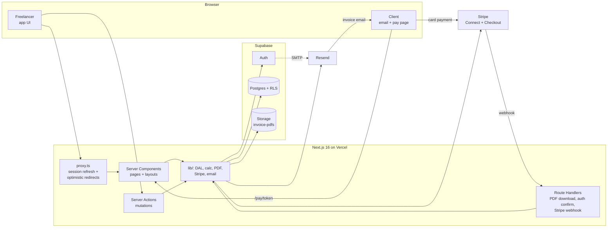
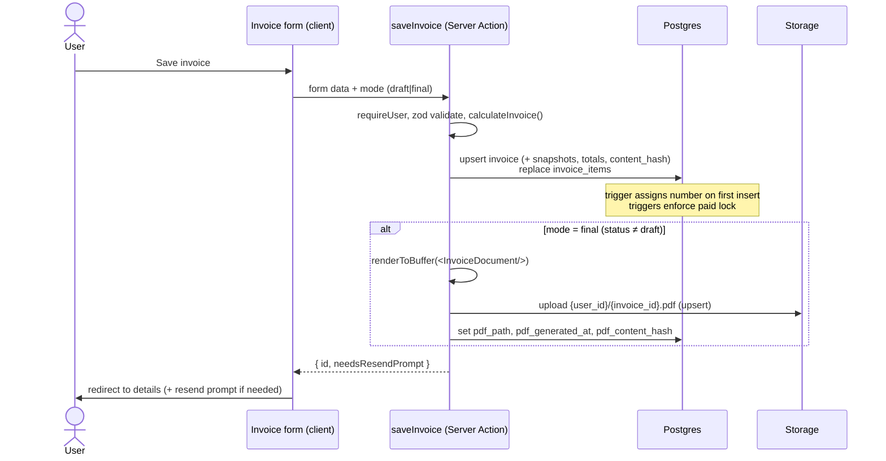
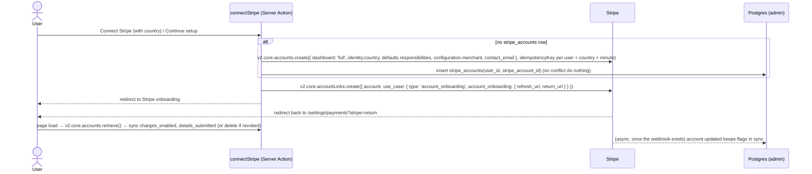

# Invoice Generator: Technical Architecture

| | |
|---|---|
| **Version** | 1.0 |
| **Date** | 24 Nov 2026 |
| **Related docs** | [PRD.md](PRD.md) (what to build) · [DB.md](DB.md) (schema, RLS, SQL) · [UI-rules.md](UI-rules.md) (UI conventions) · [../AGENTS.md](../AGENTS.md) (agent rules) |

This document covers **how** the product in [PRD.md](PRD.md) gets built: stack, services, structure and the main flows.

> **Before writing code:** this project runs **Next.js 16**, which has breaking changes compared with older versions. Read the relevant guide in `node_modules/next/dist/docs/` before implementing any Next.js feature (see `AGENTS.md`). Supabase and Stripe also change often, so check their current docs for anything marked *verify* below.

---

## 1. Stack overview

### 1.1 Already installed

| Area | Package | Version | Notes |
|---|---|---|---|
| Framework | `next` | 16.4.6 | App Router, Turbopack. `next.config.ts` enables `cacheComponents`, `partialPrefetching`, `experimental.agentFeedback` |
| UI runtime | `react`, `react-dom` | 19.3.0 | |
| Styling | `tailwindcss`, `@tailwindcss/turbopack` | 4.3.3 | CSS-first config in `app/globals.css` |
| Components | `shadcn` (CLI), `@base-ui/react` | 4.23 / 1.9 | Preset `b7VWMYRFqd`, style `base-vega` (built on Base UI). See `components.json` |
| Variants / classes | `class-variance-authority`, `cn` | | Use `cn` from `@/lib/utils` only. No `clsx` / `tailwind-merge` |
| Icons | `@phosphor-icons/react` | 2.1 | The only icon library (no Lucide). Server Components import from `@phosphor-icons/react/ssr` |
| Animation | `tw-animate-css` | 1.4 | |
| Supabase | `@supabase/ssr`, `@supabase/supabase-js` | 0.12 / 2.119 | Clients in `lib/client.ts`, `lib/server.ts`, `lib/middleware.ts` |
| Email | `resend`, `react-email`, `@react-email/render` | 6.39 / 6.11 / 2.3 | `sendEmail()` helper in `lib/email/index.ts` |
| Guard | `server-only` | | Marks server-only modules |
| PDF | `@react-pdf/renderer` | 4.9.0 | Invoice PDFs (§9). In Next's built-in `serverExternalPackages` list |
| Dates | `date-fns`, `react-day-picker` | 4.4.0 / 10.0.2 | Date maths; the shadcn Calendar behind the date pickers |
| Forms | `zod`, `react-hook-form`, `@hookform/resolvers` | 4.6 / 7.92 / 7.0 | Shared schemas, shadcn Field + RHF pattern |
| Tests | `vitest` (dev) | 4.1 | Unit tests next to the code they cover |
| Language | TypeScript (strict), ESLint 9 + `eslint-config-next` | | Path alias `@/*` → project root |

### 1.2 Added for payments

| Package | Version | Why |
|---|---|---|
| `stripe` | 23.2.0 | Stripe Node SDK: Connect onboarding (Accounts v2), Checkout Sessions, webhook verification. Pins API version `2026-11-18` |

Install everything with exact versions and commit the lockfile.

### 1.3 Services

| Service | Used for |
|---|---|
| **Vercel** | Hosting the Next.js app (production + preview deployments) |
| **Supabase** | Auth (email + password), Postgres (data + RLS), Storage (private PDF bucket). Project is connected via the Supabase MCP server (`.mcp.json`) |
| **Stripe** | Connect (each freelancer's own account), Checkout (card payments), webhooks (automatic "paid" status) |
| **Resend** | Transactional email: invoice emails (API) and Supabase auth emails (SMTP) from the verified domain |

---

## 2. Architecture



**Key ideas**

- **Server-first.** Pages are Server Components that read data on the server. Mutations are Server Actions. Client Components are used only for interactive parts (forms, dialogs, menus, filters).
- **Two layers of authorization.** Every server function checks the session (data access layer), **and** Postgres Row Level Security checks ownership on every query. Business invariants (paid lock, numbering) are enforced by database triggers, so they hold even for code that bypasses RLS.
- **The secret key is used rarely.** Only three places use the Supabase secret key (admin client): the Stripe webhook, the public pay page, and writes to `stripe_accounts`.
- **No client-side Supabase queries for app data.** The browser Supabase client is used only by the auth forms. Everything else goes through Server Components and Server Actions.

---

## 3. Next.js 16 conventions used in this project

| Topic | Convention | Docs |
|---|---|---|
| **Proxy (formerly middleware)** | A root `proxy.ts` exports `proxy()` and calls `updateSession()`. **It doesn't exist yet. Create it.** Proxy only refreshes the Supabase session cookie and does *optimistic* redirects. It is **not** the security boundary | `01-app/01-getting-started/16-proxy.md`, `03-api-reference/03-file-conventions/proxy.md` |
| **Public routes** | The allowlist in `updateSession` must be updated. Public: `/`, `/auth/*`, `/pay/*`, `/api/stripe/webhook`. Everything else redirects to `/auth/login?next=<path>` when there's no session | |
| **Cache Components** (`cacheComponents: true`) | Reading `cookies()` / the session or user data outside `<Suspense>` is a build error. Pattern: the static shell (layout, nav, headings) renders immediately, and anything that reads the session or DB is in an async component inside `<Suspense fallback={<Skeleton/>}>`. Don't `await` the session at the top level of a layout. User data is **not** cached with `use cache` in v1 (per-user, RLS-scoped, changes often) | `02-guides/authentication-with-cache-components.md`, `01-getting-started/08-caching.md`, `02-guides/streaming.md` |
| **Typed routes** | Use the global `PageProps<'/invoices/[id]'>`, `LayoutProps<'/'>` and `RouteContext<'/invoices/[id]/pdf'>` helpers. `params` and `searchParams` are Promises | `03-api-reference/03-file-conventions/page.md` |
| **Mutations** | Server Actions in `actions.ts` files (`'use server'`). Every action: (1) `requireUser()`, (2) zod-validate input, (3) do the work, (4) `revalidatePath()` / `refresh()`, (5) return a typed result or `redirect()` | `01-getting-started/07-mutating-data.md`, `02-guides/server-actions.md`, `02-guides/forms.md` |
| **Security of actions** | Treat every Server Action as a public HTTP endpoint: never trust IDs from the client without an ownership check (RLS handles it if the user-session client is used) | `02-guides/data-security.md` |
| **Route Handlers** | Used only for: auth confirm (`GET`), PDF download (`GET`), Stripe onboarding refresh (`GET /settings/payments/refresh`), Stripe webhook (`POST`, raw body) | `01-getting-started/15-route-handlers.md` |
| **Partial prefetching** | Enabled. Keep the static shell meaningful so navigations feel instant | `02-guides/adopting-partial-prefetching.md` |
| **`next.config.ts`** | `serverExternalPackages: ["@react-email/render"]`: React Email renders with `react-dom/server`, which throws when bundled for React Server Components (Server Actions), so it's loaded from `node_modules`. `outputFileTracingIncludes` adds `lib/pdf/fonts/*.ttf` to the `/invoices/**` and `/clients/**` routes: the PDF reads its fonts from disk, where file tracing can't see them | `05-config/01-next-config-js/output.md`, `serverExternalPackages.md` |

---

## 4. Project structure

```
app/
  layout.tsx                      # root layout (fonts, <Toaster/>)
  globals.css                     # theme tokens (shadcn preset)
  (marketing)/
    page.tsx                      # landing (placeholder in v1)
  auth/
    login/page.tsx
    sign-up/page.tsx
    sign-up-success/page.tsx
    forgot-password/page.tsx
    update-password/page.tsx
    error/page.tsx
    confirm/route.ts              # GET: verifyOtp(token_hash, type) → redirect
  (app)/
    layout.tsx                    # app shell: header (session read inside Suspense)
    dashboard/page.tsx
    invoices/
      page.tsx                    # list (searchParams: page, status, client, from, to, q)
      actions.ts                  # create/update/finalize/delete/duplicate/markPaid/send
      new/page.tsx
      [id]/page.tsx               # details / preview
      [id]/edit/page.tsx
      [id]/pdf/route.ts           # GET: stream PDF from storage
    clients/
      page.tsx                    # list (searchParams: page, q)
      actions.ts                  # save / delete summary / delete
      new/page.tsx
      [id]/page.tsx
      [id]/edit/page.tsx
      [id]/not-found.tsx          # missing or someone else's client
    settings/
      profile/page.tsx
      payments/page.tsx           # Stripe Connect status + connect/continue
      payments/refresh/route.ts   # GET: new onboarding link when Stripe's expired
      actions.ts                  # updateProfile, connectStripe
  pay/
    [token]/page.tsx              # public pay page
    [token]/actions.ts            # startCheckout (Server Action)
    [token]/success/page.tsx      # thank you (+ number and amount)
    layout.tsx                    # public, no app shell, noindex, no referrer
  api/
    stripe/webhook/route.ts       # POST: Stripe Connect webhook

components/
  ui/                             # shadcn components (generated, don't hand-edit unless needed)
  app-shell/                      # app-header, main-nav, mobile-nav (sheet), nav-links,
                                  # nav-items (text-only items), nav-user (user menu)
  settings/                       # settings-nav, profile-form, payments-panel
  pay/                            # pay-panel (summary + Pay now, end states)
  dashboard/                      # profile-banner
  invoices/                       # invoice-form, line-items-editor (+ live totals), date-picker,
                                  # status-badge, invoice-preview, invoice-actions (row menu,
                                  # detail buttons), send-dialog, confirm-dialogs (mark paid,
                                  # delete, resend prompt), invoices-filters, invoices-table,
                                  # invoices-pagination, list-params, breadcrumb, deleted notice
  clients/                        # client-form, client-fields, use-save-client, duplicate- and
                                  # delete-client-dialog, add-client-dialog, client-combobox
                                  # (for the invoice form), table, row/detail actions, search,
                                  # pagination, list-params, breadcrumb, deleted notice
  forms/                          # shared form helpers: unsaved-changes ("Discard changes?"),
                                  # use-url-search (search as you type into `?q=`)

emails/
  invoice-email.tsx               # React Email template

lib/
  utils.ts                        # cn (existing)
  is-navigation-error.ts          # a Server Action rejected because it redirected
  supabase/
    client.ts                     # browser client   (moved from lib/client.ts)
    server.ts                     # server client    (moved from lib/server.ts)
    proxy.ts                      # updateSession    (moved from lib/middleware.ts)
    admin.ts                      # secret-key client, server-only
    database.types.ts             # generated types
    filters.ts                    # escaping user text in PostgREST filters (§8.4)
  dal/                            # server-only data access layer
    auth.ts                       # getUser(), requireUser()
    profile.ts  clients.ts  invoices.ts  stripe-accounts.ts  pay.ts  dashboard.ts
  invoices/                       # pure, no I/O, unit tested
    calc.ts                       # pure totals maths (shared client + server)
    money.ts                      # typed price / VAT / quantity → cents / basis points
    format.ts                     # formatDate, formatMoney, formatQuantity, formatVatRate
    dates.ts                      # local today, + 14 days
    content-hash.ts               # hash of PDF-relevant content (node:crypto)
    snapshot.ts                   # profile/client → snapshot columns
    document.ts                   # stored row + items → PDF/preview data, form values
    names.ts  email-text.ts       # sender / greeting names, subject, default message, From header
    status.ts                     # isOverdue, allowedActions(invoice), status filters
  validation/
    fields.ts                     # shared zod fields (optional text / email)
    profile.ts  client.ts  invoice.ts   # zod schemas (draft vs final), send schema
    *.test.ts                     # Vitest unit tests next to the schema they cover
  pdf/
    invoice-document.tsx          # @react-pdf/renderer layout
    render.ts                     # renderToBuffer + upload to storage
    fonts/                        # TTF files with Latin Extended glyphs
  stripe/
    index.ts                      # Stripe client (server-only)
    connect.ts                    # create account, account links, account status (Accounts v2)
    checkout.ts                   # create/retrieve/expire Checkout Sessions
    payment-link.ts               # pure: minimums, link decision, dialog note (unit tested)
    token.ts                      # payment token generator
    webhook.ts                    # event handlers (with the webhook)
  email/
    index.ts                      # sendEmail() (a React element, or rendered html + text)
    send-invoice.ts               # render the invoice email and send it

proxy.ts                          # root proxy → lib/supabase/proxy.ts
vitest.config.mts                 # unit tests (node env, "@/…" alias from tsconfig)
```

**Housekeeping in the first milestone**

- Move `lib/client.ts`, `lib/server.ts`, `lib/middleware.ts` into `lib/supabase/`. Nothing imports them yet.
- Replace the create-next-app `app/page.tsx` and update `metadata` in `app/layout.tsx`.
- Add `<Toaster />` (shadcn `sonner`) to the root layout.

---

## 5. Authentication

| Item | Implementation |
|---|---|
| Method | Supabase Auth, email + password. **Confirm email** must be ON in the Supabase dashboard (Auth → Providers → Email) |
| UI | Use the Supabase UI block `password-based-auth-nextjs` from the `@supabase` registry already set in `components.json` (`npx shadcn@latest add @supabase/password-based-auth-nextjs`), then restyle with the project's shadcn components. It provides the pages listed in §4. *Verify* the block's current file layout, because it may write its own client files: keep only one set of clients in `lib/supabase/` |
| Confirm / reset links | Email templates point to `/auth/confirm?token_hash={{ .TokenHash }}&type=email` (signup) and `type=recovery` (reset). The route handler calls `supabase.auth.verifyOtp({ type, token_hash })` and redirects to `next` (`/dashboard` or `/auth/update-password`) |
| Session | Cookie-based via `@supabase/ssr`. `proxy.ts` refreshes it on each request (`getClaims()`) |
| Server check | `lib/dal/auth.ts`: `getUser()` returns the user or null. `requireUser()` redirects to `/auth/login?next=…`. Both are wrapped in React `cache()` for per-request dedupe. Use `supabase.auth.getClaims()` (verifies the JWT), never `getSession()` for authorization. `getUser()` starts with `await io()` (`next/cache`): with partial prefetching `cookies()` resolves during the session's App Shell prerender, and `getClaims()` reads `Date.now()`, which Next.js rejects there |
| Auth emails | Supabase → Auth → SMTP settings: **custom SMTP via Resend** (`smtp.resend.com`, port 465, user `resend`, password = a Resend API key, sender on the verified domain). The default Supabase SMTP is rate-limited and may only deliver to team members |
| Redirect URLs | Supabase Auth → URL configuration: Site URL = production URL; allowed redirects: `http://localhost:3000/**`, the production URL, and Vercel preview URLs (`https://*-<team>.vercel.app/**`) |
| Profile row | Created automatically by a DB trigger on `auth.users` insert, with email pre-filled (see [DB.md](DB.md)) |

---

## 6. Data access & security

### 6.1 Supabase clients

| Client | File | Key | Used by |
|---|---|---|---|
| Browser | `lib/supabase/client.ts` | publishable | Auth forms only |
| Server (user session) | `lib/supabase/server.ts` | publishable + user cookie | All Server Components, Server Actions, PDF route. **RLS applies** |
| Proxy | `lib/supabase/proxy.ts` | publishable | Session refresh |
| Admin | `lib/supabase/admin.ts` (`import 'server-only'`) | **secret** (`SUPABASE_SECRET_KEY`) | Only: Stripe webhook, pay page + checkout action, `stripe_accounts` writes. **Bypasses RLS**, so always filter explicitly |

Create a new server client per request (no globals), as the existing comments say.

### 6.2 Data access layer (`lib/dal/*`)

- Every module starts with `import 'server-only'`.
- Functions take typed arguments, call `requireUser()`, use the user-session client, and return **narrow DTOs** (only the fields the UI needs).
- Pages and actions call the DAL, never Supabase directly. That keeps queries in one place and makes them easy to test and review.

### 6.3 Defence in depth

| Layer | Responsibility |
|---|---|
| `proxy.ts` | Optimistic redirect of logged-out users (UX only) |
| DAL / Server Actions | Session check, input validation (zod), business rules (e.g. "can send?") |
| RLS policies | Row ownership on every table: `(select auth.uid()) = user_id` |
| DB triggers | Invariants: paid invoices immutable/undeletable, no paid → unpaid, number immutable, line items locked when parent is paid |
| Storage policies | Users can only access `invoice-pdfs/{their user id}/…` |

### 6.4 Database types

Generate with the Supabase MCP `generate_typescript_types` (or `supabase gen types typescript`) into `lib/supabase/database.types.ts`, and pass the `Database` generic to every client. Regenerate after each migration.

### 6.5 Migrations

Schema changes are SQL migrations (see [DB.md](DB.md) §9). Apply them through the Supabase MCP `apply_migration` (named, e.g. `001_initial_schema`), then run `get_advisors` (security + performance) and fix any warnings.

---

## 7. Money & invoice calculations

All in `lib/invoices/calc.ts`: **pure functions, no I/O**, imported by both the client form (live totals) and the server (authoritative totals that get stored). Unit tested.

| Rule | Implementation |
|---|---|
| Storage unit | **Integer minor units (cents)** everywhere: `bigint` in DB, `number` in TS (safe up to 2^53) |
| Input | The price field accepts up to 2 decimals → parse to cents with string maths (no float multiplication) |
| Quantity | Integer ≥ 1. `flat` ⇒ forced to 1 |
| VAT rate | Stored as `numeric(5,2)` (0–100). In TS, keep it as **basis points** (`17.5% → 1750`) to stay in integer maths |
| Line net | `netCents = quantity × unitPriceCents` |
| Line VAT | `vatCents = roundHalfUp(netCents × rateBp / 10000)`, rounded **per line** |
| VAT breakdown | Group lines by rate → `[{ rateBp, netCents, vatCents }]`, sorted by rate |
| Totals | `subtotal = Σ net`, `tax = Σ vat`, `total = subtotal + tax` |

```ts
// lib/invoices/calc.ts (shape)
export type LineInput = { unit: 'hours' | 'flat'; quantity: number; unitPriceCents: number; vatRateBp: number }
export type LineResult = LineInput & { netCents: number; vatCents: number }
export type Totals = {
  lines: LineResult[]
  vatBreakdown: { rateBp: number; netCents: number; vatCents: number }[]
  subtotalCents: number
  taxCents: number
  totalCents: number
}
export function calculateInvoice(lines: LineInput[]): Totals
```

**Formatting** (`lib/invoices/format.ts`, fixed, English):
- `formatDate(date)` → `24 Nov 2026` (`Intl.DateTimeFormat('en-GB', { day: 'numeric', month: 'short', year: 'numeric' })`).
- `formatMoney(cents, currency)` → `EUR 1,234.56` (`currency` code + `Intl.NumberFormat('en-US', { minimumFractionDigits: 2, maximumFractionDigits: 2 })`).
- `formatQuantity(qty, unit)` → `10 h` / `Flat`.
- `formatVatRate(rateBp)` → `17%`, `7.5%`.

**Dates:** `invoice_date` and `due_date` are SQL `date` (no time zone). The form defaults use the **browser's local date** (today, today + 14 days). "Overdue" is computed on the server as `status = 'unpaid' AND due_date < current_date`, which is UTC. That's an accepted simplification: the badge may appear up to a day early or late around midnight.

---

## 8. Invoice flows

### 8.1 Validation schemas (`lib/validation/invoice.ts`)

- `invoiceDraftSchema`: relaxed (dates, currency, line shapes; client and descriptions optional).
- `invoiceFinalSchema`: `invoiceDraftSchema` + client required, ≥ 1 line, descriptions required, total > 0.
- `sendInvoiceSchema`: `{ invoiceId, message (≤ 5,000 chars), attemptId (uuid) }`.

The same schemas run in the browser (react-hook-form resolver) and in the Server Actions.

### 8.2 Save (create / update / finalize)



Details:

- **Snapshots** (`lib/invoices/snapshot.ts`): on create, copy the profile into `sender_*` and the selected client into `client_*`. On update, re-copy **only** if the user clicked *Refresh details* or picked a different client.
- **Atomic write:** the invoice row and its line items are saved through **one RPC**, `save_invoice(p_invoice jsonb, p_items jsonb)` (`security invoker`, so RLS applies). It inserts or updates the invoice and **replaces** all line items in one transaction, so a failure can't leave half-saved items. Items carry `position` (0…n-1) for ordering. See [DB.md](DB.md) §4.
- **content_hash** (`lib/invoices/content-hash.ts`): SHA-256 over a canonical JSON of everything that appears on the PDF (dates, currency, sender/client snapshots, lines, comments; totals follow from the lines). The **invoice number is left out**: the insert trigger assigns it after the hash is computed, and it never changes afterwards, so it can't make two versions of an invoice differ. Two uses:
  - skip PDF regeneration when `content_hash === pdf_content_hash`,
  - `needsResendPrompt = first_sent_at != null && content_hash changed in this save && content_hash !== last_sent_content_hash` (saving again without changes doesn't ask again, PRD §6.8 AC4). The form then opens the details page with `?resend=1`, which shows the prompt and drops the parameter.
- **PDF failure:** the invoice save still succeeds. `pdf_content_hash` stays stale. Download/Send detect `pdf_content_hash !== content_hash` and regenerate before continuing.

### 8.3 Other actions (`app/(app)/invoices/actions.ts`)

| Action | Steps |
|---|---|
| `deleteInvoice(id)` | requireUser → load invoice (must be draft/unpaid) → if `stripe_checkout_session_id`, **expire** it on the connected account → delete PDF from storage → delete row (items and email log cascade) → `revalidatePath('/invoices')` |
| `duplicateInvoice(id)` | Load source → insert new **draft** with fresh snapshots, today / +14 days, same currency, lines and comments → redirect to `/invoices/{new}/edit` |
| `markInvoicePaid(id)` | requireUser → update `status='paid', paid_at=now(), paid_method='manual', paid_amount_cents=total_cents, paid_currency=currency` **where status='unpaid'** → expire any open Checkout Session |
| `sendInvoice(input)` | See §10 |

### 8.4 Invoice list query

- `.from('invoices').select('id, invoice_number, status, invoice_date, due_date, currency, total_cents, client_display_name, last_sent_at', { count: 'exact' })`
- Filters: `status` (Overdue = `status=unpaid AND due_date < today`), `client_id`, `invoice_date` between `from`/`to`.
- Search `q`: `.or('invoice_number.ilike.%q%,client_display_name.ilike.%q%,client_full_name.ilike.%q%')`. **Escape** `,`, `(`, `)`, `%` and `_` in `q` before building the filter string.
- Order `invoice_date desc, created_at desc`. Paginate with `.range((page-1)*20, page*20-1)`.
- Filters live in `searchParams`. The filter bar is a Client Component that updates the URL (`router.replace`) and resets `page`.

### 8.5 Dashboard

One RPC: `dashboard_summary()` (security invoker, see [DB.md](DB.md)) returns per-currency outstanding / overdue / paid-this-month. Plus a separate query for the 5 most recent invoices. Each widget sits in its own `<Suspense>` with a skeleton.

---

## 9. PDF generation

| Item | Implementation |
|---|---|
| Library | `@react-pdf/renderer`: `renderToBuffer(<InvoiceDocument data={…} />)` in Server Actions / route handlers (Node.js runtime, the default) |
| Component | `lib/pdf/invoice-document.tsx`: `<Document><Page size="A4">` with the sections in the order from PRD §6.6. Line items header uses `fixed` so it repeats. Footer uses `render={({ pageNumber, totalPages }) => …}` for "Page X of Y". `InvoiceDocument({ data })` returns the `<Document>` element itself, which is what `renderToBuffer` is typed to take |
| Fonts | **Inter** 4.1 static TTFs (Regular, SemiBold, Bold; OFL, licence in `lib/pdf/fonts/OFL.txt`), registered with `Font.register` from an absolute path built from `process.cwd()` and traced into deployments by `outputFileTracingIncludes` (§3). The built-in Helvetica can't render č/ć/đ/š/ž. Hyphenation is off (`Font.registerHyphenationCallback(w => [w])`). "Page X of Y" is only printed when there are 2+ pages |
| Data | The component receives a plain DTO (snapshots, lines with computed amounts, VAT breakdown, totals) plus `format.ts` helpers. **No DB access inside the component** |
| Storage | Private bucket `invoice-pdfs`, object key `{user_id}/{invoice_id}.pdf`, uploaded with `upsert: true` and `contentType: 'application/pdf'` using the **user-session** client (storage RLS applies) |
| Download | `app/(app)/invoices/[id]/pdf/route.ts` (`GET`): requireUser → load invoice (RLS) → regenerate if stale → `storage.download(path)` → `new Response(body, { headers: { 'Content-Type': 'application/pdf', 'Content-Disposition': 'attachment; filename="Invoice-2026-001.pdf"' } })` |
| Preview | The details page renders the invoice as **HTML** (`components/invoices/invoice-preview.tsx`) mirroring the PDF layout, not an embedded PDF, so it works well on mobile |
| Drafts | No PDF. Download is disabled for drafts. Send finalizes the draft (generating its PDF) first |

---

## 10. Email sending (Resend)

### 10.1 Flow: `sendInvoice({ invoiceId, message, attemptId })`

1. `requireUser()`; zod-validate.
2. Load the invoice (RLS). Reject if `paid`. If `draft`, run the final schema and **finalize** first (status → `unpaid`, generate PDF).
3. Check preconditions: client email present, profile has (name or company) and email.
4. Make sure the PDF is current (regenerate if `pdf_content_hash !== content_hash`). Download it from storage as a `Buffer`.
5. **Payment link decision (in memory, nothing written yet)**, `decidePaymentLink()` in `actions.ts`: load `stripe_accounts` for the user and **check it live with Stripe** (`syncStripeAccount`, falls back to the stored flags if Stripe can't be reached). Include a link only if `charges_enabled` and `total_cents ≥ STRIPE_MINIMUM_CENTS[currency]` (`lib/stripe/payment-link.ts`: EUR 50, USD 75, GBP 50, BAM 100, chosen so the charge clears Stripe's minimum whatever currency the connected account settles in). If included, use the existing `payment_token`, or generate one (`lib/stripe/token.ts`: `randomBytes(24).toString('base64url')`) to build the link URL. The send dialog shows the same decision from the **stored** flag (`SendDetails.payment`), and the success toast says so if the live check removed the link.
6. Render `emails/invoice-email.tsx` to HTML and plain text with `@react-email/render` (`lib/email/send-invoice.ts`), and call `sendEmail()` with `html` + `text`:
   - `from`: `"<Sender name> via Invoice Generator <address from EMAIL_FROM>"` (strip `"`, `<`, `>` from the name),
   - `replyTo`: profile email,
   - `to`: client email,
   - `subject`: `Invoice 2026-001 from <Sender name>`,
   - `attachments: [{ filename: 'Invoice-2026-001.pdf', content: pdfBuffer }]`,
   - `idempotencyKey: \`invoice-send/${invoiceId}/${attemptId}\`` (the dialog generates `attemptId` on the first Send and **reuses** it on Retry, so double clicks and retries never send twice. Editing the message starts a new attempt, because Resend rejects a reused key with a different body).
7. Insert a row into `invoice_emails` (status `sent`/`failed`, Resend id or error).
8. **On success**, in one update: `first_sent_at` (if null), `last_sent_at = now()`, `last_sent_content_hash = content_hash`, and, if a link was included, `payment_token`, `payment_amount_cents = total_cents`, `payment_currency = currency`. If the amount changed and an open Checkout Session exists, **expire** it, so the client's next click charges the new amount. Return `{ ok: true }`.
9. **On failure:** return `{ ok: false, error }`. The dialog shows the error + **Retry**. No payment fields were written, so a failed send never changes what the existing link charges.

### 10.2 Template (`emails/invoice-email.tsx`)

React Email components (check the exports of the installed `react-email` package). Content: the user's message (plain text, line breaks kept, **escaped**), a summary card (number, total, due date), a **Pay invoice** button linking to `${NEXT_PUBLIC_APP_URL}/pay/${payment_token}` when included, and a small footer ("Sent via Invoice Generator"). Simple inline-styled layout that works in all mail clients.

### 10.3 Sender domain

`EMAIL_FROM` must be on a domain verified in Resend (SPF/DKIM DNS records). `onboarding@resend.dev` only works for testing to the account owner's address.

---

## 11. Payments (Stripe Connect)

### 11.1 Model

- **Connected accounts with full Stripe Dashboard access** (equivalent to *Standard* accounts). The freelancer owns the account, pays Stripe fees, and handles disputes/refunds in their own dashboard.
- **Direct charges:** Checkout Sessions are created **on the connected account** (`{ stripeAccount: acct_… }`). Money goes straight to the freelancer. **No `application_fee_amount`.**
- Card only: `payment_method_types: ['card']`.

- **Accounts v2 API** (`stripe.v2.core.accounts`), which Stripe recommends for new Connect platforms (new platforms may even need to enable v1 separately): `dashboard: 'full'`, `identity.country`, `defaults.responsibilities: { fees_collector: 'stripe', losses_collector: 'stripe' }`, `configuration.merchant.capabilities.card_payments.requested: true`. This is the v2 equivalent of a Standard account. **v2 requires `identity.country` before `configuration.merchant`, and a full dashboard requires the merchant configuration**, so the app asks for the country in the Connect dialog (list from `countrySpecs.list()`, cached 12 h, default `HR`). v1 without a country silently defaults to the platform's country (HR), so it wasn't used. Stripe's hosted onboarding collects everything else. v2 account ids are ordinary `acct_…` ids, so Checkout Sessions still use the `stripeAccount` header.
- **Flags from a v2 account** (`lib/stripe/connect.ts` `fetchAccountStatus`, retrieved with `include: ['configuration.merchant', 'requirements']`): `charges_enabled` = `configuration.merchant.capabilities.card_payments.status === 'active'`; `details_submitted` = no `requirements.entries` with `awaiting_action_from: 'user'` that are currently or past due. A closed account, or a `403 StripePermissionError` / 404 (the account disconnected from the platform) counts as **revoked**: the `stripe_accounts` row is deleted.
- **Stripe API version:** pinned by the SDK (`stripe@23.2.0` → `2026-11-18`). In this version Checkout Sessions take `allowed_payment_method_types` (the old `payment_method_types` was removed).

### 11.2 Onboarding (`settings/payments`)



- `refresh_url`: `app/(app)/settings/payments/refresh/route.ts` creates a new Account Link and redirects (links expire quickly). On failure it redirects to `/settings/payments?stripe=error`.
- The page shows **Not connected / Setup incomplete / Connected** after the live sync. "Setup incomplete" = `charges_enabled` false; with `details_submitted` true it says Stripe is reviewing. Connected shows the account's `display_name` or `contact_email`. `?stripe=return|error` shows a toast once, then is removed from the URL.
- The account email is the profile email, or the login email if the profile has none.
- **Live checks until the webhook exists:** there is no `account.updated` / `account.application.deauthorized` yet, so the account is checked with Stripe on the Payments page, at every send, and on every **Pay now**. The pay page itself and the send dialog use the stored flag.
- "Open Stripe dashboard" links to `https://dashboard.stripe.com` (full-dashboard accounts log in themselves).

### 11.3 Pay page and checkout

```mermaid
sequenceDiagram
    actor C as Client
    participant P as /pay/[token] (RSC, admin client)
    participant A as startCheckout (Server Action)
    participant S as Stripe (connected account)
    participant W as /api/stripe/webhook
    participant DB as Postgres

    C->>P: open link
    P->>DB: find invoice by payment_token (narrow select)
    P-->>C: summary + Pay now (or paid / invalid / unavailable state)
    C->>A: Pay now
    A->>DB: re-check: status = unpaid
    A->>S: live account check (charges_enabled)
    A->>S: retrieve previous session (if any): paid → "paid" state; open with same amount → reuse its url; other open → expire
    A->>S: checkout.sessions.create({ mode: 'payment', line_items: [{ price_data: { currency, unit_amount: payment_amount_cents, product_data: { name: 'Invoice 2026-001' } }, quantity: 1 }], allowed_payment_method_types: ['card'], customer_email, client_reference_id: invoice.id, metadata: { invoice_id }, payment_intent_data: { metadata: { invoice_id } }, locale: 'auto', expires_at: ~1 h, success_url (with {CHECKOUT_SESSION_ID}), cancel_url (?cancelled=1) }, { stripeAccount, idempotencyKey })
    A->>DB: save stripe_checkout_session_id (where status = unpaid)
    A-->>C: redirect to session.url
    C->>S: pays by card
    S-->>C: redirect to /pay/[token]/success
    S->>W: checkout.session.completed (event.account = acct_…)
    W->>DB: mark paid (once)
```

- The pay page uses the **admin client** (the client isn't logged in) and selects **only** the fields it shows. Unknown token → "link no longer valid".
- `payment_amount_cents` / `payment_currency` (set at the last successful send) are what's charged, **not** the current `total_cents`. That's how "the old link keeps working until resend" is implemented.
- The success page says thank you, plus the invoice number and amount when the `session_id` it gets back is a paid session of this invoice (checked on the connected account against `metadata.invoice_id`). It doesn't mark anything paid (the webhook does).
- **Until the webhook ships**, online payments don't change the invoice's status. To keep a client from paying twice meanwhile, the pay page and **Pay now** look at the invoice's last Checkout Session: if it's `complete` + `paid`, they show "This invoice has been paid" (nothing is written).
- **Idempotency key:** `checkout/<invoice>/<currency>/<amount>/<previous session>/<minute>`, and `expires_at` is derived from the same minute, so two clicks in one minute send identical requests (Stripe rejects a reused key with different parameters).
- **Expiring sessions** (`expireCheckoutSessions`) is best effort: on delete, mark as paid, client delete and resend-with-new-amount, a failure is logged and the app action still goes ahead. A session that's already expired or complete is skipped.
- Pages under `/pay` are `noindex` and send no referrer (the token is in the URL). They're outside the app shell and don't read the session.
- Stripe minimum charge amounts are checked at send time (see §10.1 step 5). BAM is a supported presentment currency; it's pegged to the euro, so BAM 1.00 clears EUR 0.50.

### 11.4 Webhook (`app/api/stripe/webhook/route.ts`)

- Configure **one endpoint for Connect events** ("Events on connected accounts") in Stripe → `https://<domain>/api/stripe/webhook`. Its signing secret goes in `STRIPE_WEBHOOK_SECRET`.
- `POST(request)`: `const body = await request.text()` (raw body is required), `stripe.webhooks.constructEvent(body, request.headers.get('stripe-signature'), secret)`. Return **400** on bad signature.
- **Idempotency:** insert `event.id` into `stripe_events`. If it already exists with `processed_at` set, return 200 immediately. After handling, set `processed_at`. On handler error return **500**, so Stripe retries.
- Handlers:

| Event | Action |
|---|---|
| `checkout.session.completed` | If `payment_status === 'paid'`: load invoice by `metadata.invoice_id`; check that `event.account` equals the owner's `stripe_accounts.stripe_account_id`; `update invoices set status='paid', paid_at=now(), paid_method='stripe', paid_amount_cents=session.amount_total, paid_currency=upper(session.currency) where id=… and status='unpaid'`. If the invoice is already paid/deleted, log it (the freelancer can refund from their Stripe dashboard) |
| `checkout.session.async_payment_succeeded` | Same as above (defensive; cards are normally synchronous) |
| `account.updated` | Sync `charges_enabled`, `details_submitted` for that `stripe_account_id` (v2 accounts still send this v1 event; reuse `syncStripeAccount` or map the v1 object's flags) |
| `account.application.deauthorized` | Delete the `stripe_accounts` row (pay pages switch to "unavailable") |

- All DB writes in the webhook use the **admin client**. The DB triggers still enforce "paid is final".
- **Local testing:** `stripe listen --forward-connect-to localhost:3000/api/stripe/webhook` (use the printed secret locally), and `stripe trigger checkout.session.completed` for smoke tests. Pay with test card `4242 4242 4242 4242`.

---

## 12. UI implementation

Follow [UI-rules.md](UI-rules.md) and `AGENTS.md`: shadcn components from the registry (via the shadcn MCP or `npx shadcn@latest add`), Phosphor icons, semantic tokens from `app/globals.css`, `cn` from `@/lib/utils`.

| Need | shadcn component(s) |
|---|---|
| App shell | Header with text-only nav links, `dropdown-menu` + `avatar` (user menu), `sheet` (mobile menu), `breadcrumb` |
| Forms | `field`, `input`, `textarea`, `label`, `select`, `combobox` (client picker), `calendar` + `popover` (date picker), `button`, `checkbox` |
| Lists | `table`, `pagination`, `badge`, `dropdown-menu` (row actions), `input` (search), `empty` |
| Feedback | `sonner` (toasts), `skeleton` (Suspense fallbacks), `alert` (banners), `spinner` |
| Dialogs | `dialog` (send, add client), `alert-dialog` (delete, mark as paid, resend prompt, discard changes) |
| Dashboard | `card` |

- **Line items editor:** `react-hook-form` `useFieldArray`. Totals recomputed with `calculateInvoice()` on every change (`useWatch`). On mobile, each line becomes a stacked card.
- **Status badge:** Draft = outline, Not paid = secondary, Paid = default/success token, Overdue = destructive. Use tokens, not hard-coded colours.
- **Responsive:** tables collapse to cards below `md`. Header nav moves into a sheet below `md`. Dialogs become full-width on small screens. Minimum supported width 360 px.
- **Pending states:** buttons show a spinner and are disabled while an action runs (`useActionState` / `useTransition`).

---

## 13. Environment variables

| Variable | Scope | Purpose | Status |
|---|---|---|---|
| `NEXT_PUBLIC_SUPABASE_URL` | public | Supabase project URL | exists |
| `NEXT_PUBLIC_SUPABASE_PUBLISHABLE_KEY` | public | Supabase publishable key | exists |
| `SUPABASE_SECRET_KEY` | server | Admin client (webhook, pay page, Stripe account writes) | exists |
| `RESEND_API_KEY` | server | Resend API | exists |
| `EMAIL_FROM` | server | `Invoice Generator <invoices@your-domain>` on the verified domain | exists |
| `STRIPE_SECRET_KEY` | server | Stripe platform secret key (`sk_test_…` / `sk_live_…`) | exists |
| `STRIPE_WEBHOOK_SECRET` | server | Signing secret of the Connect webhook endpoint | **add** with the webhook |
| `NEXT_PUBLIC_APP_URL` | public | Absolute base URL for email links and Stripe redirect URLs (`http://localhost:3000` locally) | exists (localhost until the domain is set up) |

Update `.env.example` with the new keys (no values). Never prefix secrets with `NEXT_PUBLIC_`.

---

## 14. Deployment (Vercel)

1. Connect the Git repo to Vercel. Framework preset: Next.js.
2. Set all env vars for **Production** and **Preview** (preview uses Stripe **test** keys and a test webhook endpoint).
3. Stripe: create the **Connect** webhook endpoint for the production URL. Enable Connect in the platform account (test mode first). Fill in the platform profile and branding shown during onboarding.
4. Supabase: set Site URL and redirect URLs (§5), custom SMTP via Resend, and update email templates to use `/auth/confirm`.
5. Resend: domain verified (SPF, DKIM). Optionally DMARC.
6. Run migrations on the production project before deploying code that depends on them.
7. After deploy: run the E2E checklist (§15) against production in Stripe test mode, then switch to live keys.

---

## 15. Testing

**Unit (vitest):** add `"test": "vitest"` to `package.json`.
- `calc.ts`: rounding per line, per-rate breakdown, flat qty = 1, large amounts, zero VAT.
- `format.ts`: dates, money, VAT rates, quantities.
- `content-hash.ts`: stable ordering, and a change to any PDF-visible field changes the hash.
- Validation schemas: draft vs final vs send rules from PRD §7.
- Invoice number formatting (`2026-001`, `2026-1000`).

**Database:** after applying the migration, use `execute_sql` to check that RLS isolates two test users, that a paid invoice rejects update/delete, that numbering is sequential per user/year, and that client deletion keeps paid invoices. Run `get_advisors`.

**Manual E2E checklist (Stripe test mode):**
1. Sign up → confirmation email → confirm → dashboard.
2. Forgot password → reset → login.
3. Fill in the profile. Add a client (with and without email).
4. Create a draft → finish → PDF downloads and looks right (multi-page, special characters).
5. Send without Stripe connected → email arrives, PDF attached, no pay button.
6. Connect Stripe (test) → resend → email has pay button.
7. Edit the amount → resend prompt → **Not now** → old link still charges the old amount.
8. Pay with `4242…` → success page shows number + amount → pay page shows "paid". Invoice turns Paid → locked (no edit/delete/resend) **once the webhook exists**.
9. Mark another invoice paid manually → its pay link shows "paid".
10. Delete a sent invoice → pay link shows "no longer valid".
11. Delete a client with paid + unpaid invoices (both options).
12. List: pagination, every filter, search, URL persistence. Dashboard numbers per currency.
13. Check on mobile width (360 px).

---

## 16. Suggested build order

| # | Milestone | Done when |
|---|---|---|
| 0 | **Foundation**: install packages, `proxy.ts`, move Supabase clients, env vars, apply DB migration, generate types, app shell + nav | Logged-out users are redirected, shell renders |
| 1 | **Auth**: sign-up/confirm/login/logout/forgot/reset, Resend SMTP | Full auth cycle works |
| 2 | **Profile** settings | Profile saves, validation works |
| 3 | **Clients** CRUD + combobox + delete dialog | PRD §6.4 AC pass |
| 4 | **Invoices core**: calc, form, draft/final, numbering, details, list with filters/search/pagination, duplicate, delete, mark as paid | PRD §6.5, 6.10–6.14 AC pass |
| 5 | **PDF** generation, storage, download | PRD §6.6 AC pass |
| 6 | **Email** send/resend + resend prompt | PRD §6.7–6.8 AC pass |
| 7 | **Stripe**: Connect onboarding, pay page, checkout (done); webhook (after the domain is verified) | PRD §6.3, 6.9 AC pass |
| 8 | **Dashboard**, empty states, error states, responsive pass, accessibility pass | PRD §6.15, §9, §10 |
| 9 | **Deploy** to Vercel, production config, E2E checklist | Checklist passes on production (test mode) |
| 10 | **Landing page**, built section by section | Follow-up |
